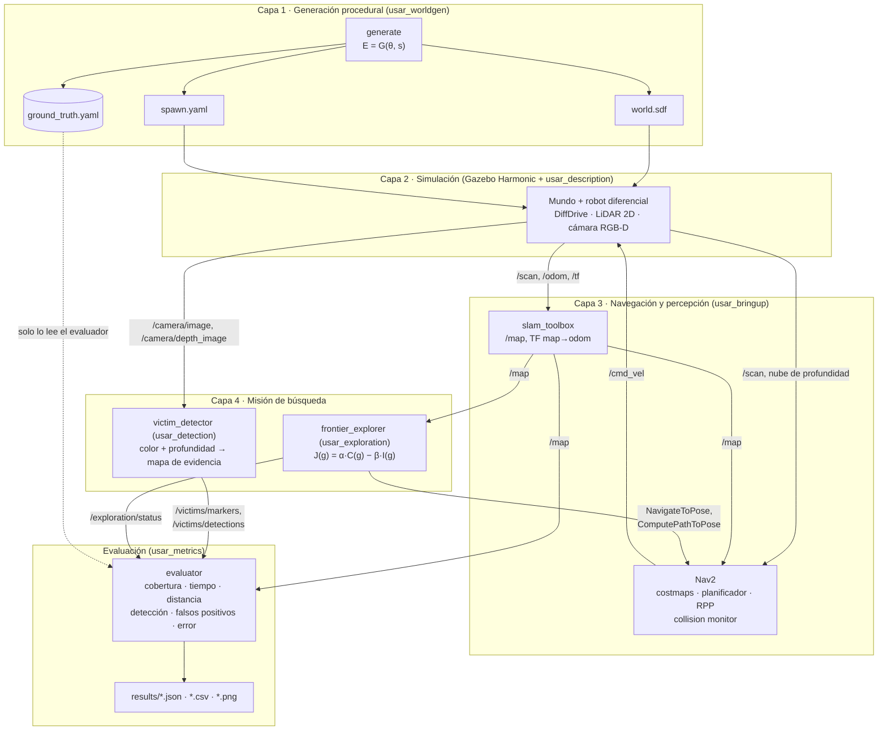

# FindbotSimulator

Robot autónomo simulado que busca víctimas entre escombros después de un sismo.

Es el Producto Mínimo Viable (MVP) de un proyecto de grado de Ingeniería Electrónica (UNAD,
metodología CDIO). Un generador procedural crea un escenario de escombros reproducible por
semilla. Un robot diferencial lo explora solo con su LiDAR, su odometría y una cámara RGB-D:
construye su propio mapa, elige a dónde ir por fronteras de exploración y detecta las víctimas
simuladas. Un evaluador independiente compara el resultado con el ground truth.

Stack: Ubuntu 24.04, **ROS 2 Jazzy**, **Gazebo Harmonic**, `ros_gz`, `slam_toolbox`, **Nav2** y
Python 3 (rclpy), todo dentro de Docker.

**Resultado** con las semillas 1 a 5 (15 min de exploración por misión): **25 de 25 víctimas
detectadas**, 1 falso positivo, cobertura del área explorable de **96.7 ± 6.4 %** y error de
localización de las víctimas de **0.25 ± 0.04 m** ([detalle](#resultados)).

---

## Contenido

- [Requisitos](#requisitos)
- [Instalación](#instalación)
- [Cómo ejecutar](#cómo-ejecutar)
- [Reproducir un experimento por semilla](#reproducir-un-experimento-por-semilla)
- [Arquitectura](#arquitectura)
- [Tópicos y parámetros principales](#tópicos-y-parámetros-principales)
- [Resultados](#resultados)
- [Limitaciones conocidas](#limitaciones-conocidas)
- [Documentación](#documentación)

---

## Requisitos

- Linux con escritorio X11 (probado en Ubuntu 24.04).
- [Docker Engine](https://docs.docker.com/engine/install/) con el plugin Docker Compose.
- GPU NVIDIA con su driver y el
  [NVIDIA Container Toolkit](https://docs.nvidia.com/datacenter/cloud-native/container-toolkit/latest/install-guide.html)
  (`docker-compose.yml` usa `runtime: nvidia`; la cámara simulada se renderiza en la GPU).
- Unos 10 GB de disco libres (la imagen ocupa unos 7 GB).

Todo lo demás (ROS 2, Gazebo, Nav2, slam_toolbox, OpenCV, SciPy, matplotlib) se instala dentro
de la imagen.

## Instalación

En el computador (fuera del contenedor):

```bash
git clone https://github.com/AngieCastano/FindbotSimulator.git
cd FindbotSimulator
printf "UID=$(id -u)\nGID=$(id -g)\n" > .env    # el contenedor usa tu mismo usuario
docker compose build                              # solo la primera vez (unos minutos)
```

Arrancar el contenedor y entrar:

```bash
xhost +local:docker            # permite abrir ventanas (una vez por sesión del escritorio)
docker compose up -d
docker exec -it findbot_sim bash
```

Dentro del contenedor (la terminal ya empieza en `~/FindbotSimulator/usar_ws`), compilar y
pasar las pruebas:

```bash
colcon build --symlink-install
source install/setup.bash
colcon test && colcon test-result --verbose
```

Las siguientes terminales que abras con `docker exec -it findbot_sim bash` cargan el workspace
solas. El contenedor se reinicia solo al reiniciar el computador (`restart: unless-stopped`); para
detenerlo: `docker compose down`.

## Cómo ejecutar

Todos los comandos van **dentro del contenedor**, uno por línea. Cierra cualquier otra simulación
antes de lanzar una nueva: comparten los tópicos de ROS.

### Misión completa (un solo comando)

```bash
ros2 launch usar_bringup mission.launch.py seed:=42
```

Genera el escenario de la semilla 42 si no existe, abre Gazebo y RViz, y el robot explora y busca
víctimas solo. Termina cuando no quedan fronteras o a los 15 min de tiempo simulado; entonces el
evaluador guarda los resultados y la misión **se cierra sola**.

| Opción | Efecto |
|---|---|
| `quick:=true` | Prueba corta: 5 min de exploración. |
| `headless:=true` | Sin Gazebo ni RViz (más liviano; para lotes). |
| `results_dir:=<carpeta>` | Dónde guardar los resultados (por defecto `results/`). |
| `detection:=false` | Sin detector de víctimas. |

En RViz se ven el mapa que construye el robot, las fronteras candidatas, la trayectoria planeada
y las víctimas: **esfera roja** con la etiqueta "Víctima k (confianza)" para las confirmadas y
esferas grises para las candidatas. El panel de la cámara muestra la segmentación del detector.

**Resultados** (en `results/`, un juego por misión):

| Archivo | Contenido |
|---|---|
| `seed42_<fecha>.json` | Resumen de las métricas y detalle por víctima. |
| `seed42_<fecha>.csv` | Evolución cada 10 s (cobertura, distancia, víctimas). |
| `seed42_<fecha>_comparison.png` | Mapa construido sobre los escombros reales, víctimas reales y estimadas, trayectoria. |
| `seed42_<fecha>_map.pgm` / `.yaml` | Mapa final (formato de `nav2_map_server`). |
| `victims_seed42_<fecha>.csv` | Log del detector: cuándo y dónde confirmó cada víctima. |

### Lote de semillas

```bash
~/FindbotSimulator/scripts/run_batch.sh 1 2 3 4 5
```

Corre las misiones una tras otra sin ventanas (unos 16 min por semilla) y al final escribe en
`results/batch_<fecha>/` la tabla `summary.md` / `summary.csv` con media y desviación estándar.
`QUICK=true` antes del comando usa misiones de 5 min. Para rehacer la tabla de un lote:
`~/FindbotSimulator/scripts/consolidate_results.py results/batch_<fecha>`.

### Partes por separado

```bash
ros2 run usar_worldgen generate --seed 7 --out worlds/seed7   # solo generar un escenario
ros2 run usar_worldgen plot --world worlds/seed7              # vista superior en PNG
ros2 launch usar_bringup sim.launch.py seed:=7                # solo el robot en Gazebo
ros2 launch usar_bringup nav.launch.py seed:=7                # + SLAM y Nav2 (metas con "2D Goal Pose" en RViz)
ros2 launch usar_bringup exploration.launch.py seed:=7        # + explorador y detector, sin evaluador
~/FindbotSimulator/scripts/teleop.sh                          # teclado, con nav.launch.py corriendo
```

El teleop pasa por un filtro de colisión: el robot frena antes de chocar aunque lo conduzcas
contra un obstáculo.

## Reproducir un experimento por semilla

1. **El escenario es reproducible:** `E = G(θ, s)`. La misma semilla `s` con los mismos
   parámetros `θ` ([default_params.yaml](usar_ws/src/usar_worldgen/config/default_params.yaml))
   genera exactamente el mismo `world.sdf` y `ground_truth.yaml` (`usar_ws/worlds/seed<s>/`).
   Los mundos no se versionan: se generan solos la primera vez que se usa la semilla.
2. **Lanzar la misión:** `ros2 launch usar_bringup mission.launch.py seed:=<s> headless:=true`.
3. **Comparar:** el JSON guarda los parámetros del mundo y del evaluador junto a las métricas.

Para otros parámetros del escenario (tamaño, número de escombros o de víctimas), copia
`default_params.yaml`, edítalo y pásalo con `world_params:=<archivo>`. Usa entonces otra carpeta
de mundos (`worlds_dir:=<carpeta>`): los mundos ya generados no se regeneran.

**La simulación no es determinista.** Gazebo, los tiempos de los nodos de ROS y la
planificación varían de una ejecución a otra, así que repetir una semilla da resultados
parecidos pero no idénticos. Por eso los resultados se dan como media y desviación estándar de
varias semillas.

## Arquitectura



**Regla de diseño:** el ground truth nunca llega al robot. Ni el explorador, ni el detector, ni
SLAM, ni Nav2 leen `ground_truth.yaml` ni poses de Gazebo; el robot decide solo con `/scan`,
`/odom`, la cámara y su propio `/map`. El evaluador lee el ground truth pero no publica nada.
Lo comprueban pruebas automáticas; la evidencia está en
[docs/auditoria_ground_truth.md](docs/auditoria_ground_truth.md).

| Paquete | Contenido |
|---|---|
| [usar_worldgen](usar_ws/src/usar_worldgen) | Generador procedural (CLI `generate`, `plot`): escombros sin solapes, zona libre en el spawn, víctimas alcanzables (flood-fill con el radio del robot). |
| [usar_description](usar_ws/src/usar_description) | Robot `findbot` (xacro), sensores y puente `ros_gz_bridge`. |
| [usar_bringup](usar_ws/src/usar_bringup) | Launch files, parámetros de slam_toolbox y Nav2, árbol de comportamiento, RViz. |
| [usar_exploration](usar_ws/src/usar_exploration) | Explorador por fronteras (Yamauchi 1997) con lista negra, vigilancia de progreso y maniobra de escape. |
| [usar_detection](usar_ws/src/usar_detection) | Detector de víctimas extensible (interfaz `SignOfLifeDetector`) y mapa de evidencia. |
| [usar_metrics](usar_ws/src/usar_metrics) | Evaluador, consolidación de lotes y pruebas de aislamiento del ground truth. |

**Robot:** diferencial, 0.40 × 0.30 m, radio de seguridad 0.30 m. LiDAR 2D de 360 muestras,
alcance de 12 m y ruido gaussiano σ = 1 cm. Cámara RGB-D de 640 × 480 a 15 Hz con un campo de
visión de 69°.

## Tópicos y parámetros principales

| Tópico | Tipo | Publica → usa |
|---|---|---|
| `/scan` | `sensor_msgs/LaserScan` | Gazebo → SLAM, costmaps, collision monitor |
| `/odom` | `nav_msgs/Odometry` | `odom_noise_sim` (odometría de ruedas de Gazebo con ruido de encoders) → SLAM, Nav2, evaluador |
| `/radar/signal` | `usar_msgs/RadarSignal` (señal IF del HB100, 20 Hz; `use_radar:=true`) | `radar_sim` (o el ESP32) → detector |
| `/camera/image`, `/camera/depth_image`, `/camera/camera_info` | `sensor_msgs/Image`, `CameraInfo` | Gazebo → detector, nube de profundidad |
| `/map` | `nav_msgs/OccupancyGrid` | slam_toolbox → Nav2, explorador, evaluador |
| `/cmd_vel` | `geometry_msgs/Twist` | collision monitor → Gazebo |
| `/cmd_vel_teleop` | `geometry_msgs/Twist` | teleop y maniobra de escape → collision monitor |
| `/exploration/status` | `std_msgs/String` | explorador → evaluador (`exploring`, `finished:<motivo>`, …) |
| `/exploration/frontiers` | `visualization_msgs/MarkerArray` | explorador → RViz |
| `/victims/markers` | `visualization_msgs/MarkerArray` | detector → RViz |
| `/victims/detections` | `usar_msgs/VictimDetectionArray` (incluye las modalidades) | detector → evaluador |
| `/victims/candidates` | `usar_msgs/VictimDetectionArray` (candidatos del sonido y del radar, sin confirmar) | detector → explorador |
| `/victims/debug_image` | `sensor_msgs/Image` | detector → RViz |

Ningún parámetro está fijo en el código: todos están en archivos YAML.

| Archivo | Parámetros clave |
|---|---|
| [usar_worldgen/config/default_params.yaml](usar_ws/src/usar_worldgen/config/default_params.yaml) | Tamaño del área (20 × 20 m), 40 escombros, 5 víctimas, radio del robot. |
| [usar_description/config/robot.yaml](usar_ws/src/usar_description/config/robot.yaml) | Dimensiones del robot y especificación de los sensores. |
| [usar_bringup/config/nav2_params.yaml](usar_ws/src/usar_bringup/config/nav2_params.yaml) | `robot_radius` 0.30 m, inflado 0.70 m, velocidad 0.35 m/s, collision monitor. |
| [usar_bringup/config/slam_toolbox.yaml](usar_ws/src/usar_bringup/config/slam_toolbox.yaml) | Resolución 0.05 m del mapa. |
| [usar_exploration/config/explorer.yaml](usar_ws/src/usar_exploration/config/explorer.yaml) | `alpha`, `beta` de J(g), `max_time` 900 s, escape. `explorer_quick.yaml`: 300 s. |
| [usar_detection/config/detector.yaml](usar_ws/src/usar_detection/config/detector.yaml) | Umbrales HSV, profundidad máxima 6 m, `min_observations` 5, mapa de evidencia. |
| [usar_metrics/config/evaluator.yaml](usar_ws/src/usar_metrics/config/evaluator.yaml) | `association_threshold` 1.0 m, periodo de muestreo 10 s. |

La justificación de cada valor está en los documentos de cada fase (ver
[Documentación](#documentación)).

## Resultados

Semillas 1 a 5, 15 min de exploración por misión, sin ventanas
(`scripts/run_batch.sh 1 2 3 4 5`):

| Semilla | Fin | Cobertura [%] | Recorrido [m] | Detectadas | Falsos positivos | Error medio [m] |
|---|---|---|---|---|---|---|
| 1 | sin fronteras (873 s) | 100.0 | 140.5 | 5 / 5 | 1 | 0.30 |
| 2 | tiempo (900 s) | 85.3 | 82.1 | 5 / 5 | 0 | 0.22 |
| 3 | tiempo (900 s) | 100.0 | 153.2 | 5 / 5 | 0 | 0.31 |
| 4 | tiempo (900 s) | 99.9 | 111.1 | 5 / 5 | 0 | 0.22 |
| 5 | tiempo (900 s) | 98.4 | 126.8 | 5 / 5 | 0 | 0.23 |
| **media ± σ** | | **96.7 ± 6.4** | 122.7 ± 27.6 | **5.0 ± 0.0** | 0.2 ± 0.4 | **0.25 ± 0.04** |

La cobertura se mide sobre el área a la que puede llegar el centro del robot. El análisis está
en [docs/fase6_metricas.md](docs/fase6_metricas.md).

## Limitaciones conocidas

- **Detección solo por color.** Las víctimas simuladas son naranjas y nada más en el escenario
  lo es. El detector no reconoce formas humanas reales ni otros signos de vida, aunque la
  interfaz `SignOfLifeDetector` permite añadirlos (calor, sonido, CO₂) sin cambiar el nodo.
- **Víctima partida en dos.** Si el robot ve los dos extremos de un cuerpo pero no su centro
  (tapado por escombros), puede confirmar dos víctimas: una cuenta como detectada, con un error
  mayor, y la otra como falso positivo. Pasó en 1 de las 5 misiones del lote.
- **Escenario simplificado:** suelo plano, escombros como cajas y cilindros, sin rampas ni
  pisos. El robot solo navega en 2D.
- **Simulación no determinista:** repetir una semilla no da exactamente el mismo resultado.
- **Fronteras inalcanzables:** el explorador puede agotar el tiempo intentando fronteras que ve
  pero a las que no puede llegar (huecos estrechos), aunque ya haya cubierto casi toda el área.
- **Atascos de Nav2:** cerca de los obstáculos, el controlador puede negarse a avanzar. El
  explorador lo detecta y hace una maniobra de escape por el filtro de colisión, pero se pierde
  tiempo.
- **Mensajes al cerrar:** al terminar la misión (o con Ctrl+C), el `collision_monitor` de Nav2
  falla al cerrarse (código −11) y `launch_ros` imprime "Cannot shutdown a ROS adapter that is not
  running". Son fallos conocidos de esas bibliotecas al apagarse y no afectan a los resultados.
- **Requiere GPU NVIDIA** tal como está configurado `docker-compose.yml`.

## Documentación

| Documento | Contenido |
|---|---|
| [docs/PLAN_MVP.md](docs/PLAN_MVP.md) | Plan del MVP por fases y criterios de aceptación. |
| [docs/fase3_parametros_nav.md](docs/fase3_parametros_nav.md) | SLAM y Nav2: capas de costmap, collision monitor, árbol de comportamiento. |
| [docs/fase4_exploracion.md](docs/fase4_exploracion.md) | Exploración por fronteras: algoritmo, parámetros, escape. |
| [docs/fase5_deteccion.md](docs/fase5_deteccion.md) | Detector de víctimas y mapa de evidencia. |
| [docs/fase6_metricas.md](docs/fase6_metricas.md) | Métricas, misión completa, lote de semillas y resultados. |
| [docs/auditoria_ground_truth.md](docs/auditoria_ground_truth.md) | Evidencia de que el ground truth no llega al robot. |
| [docs/guion_demo_exploracion.md](docs/guion_demo_exploracion.md) | Guion para presentar la demostración. |

Estructura del repositorio:

```
docker/            Dockerfile (ROS 2 Jazzy + Gazebo Harmonic)
docs/              documentación por fases
scripts/           run_batch.sh, consolidate_results.py, teleop.sh, pruebas de humo
results/           salidas de las misiones (no se versionan)
usar_ws/src/       paquetes ROS 2 (ver Arquitectura)
usar_ws/worlds/    escenarios generados (no se versionan; se regeneran por semilla)
```
