# Validación virtual del hardware del robot findbot

**Proyecto de grado — Ingeniería Electrónica, UNAD. Metodología CDIO.**
**Alcance:** circuito de la placa base, firmware del ESP32 y su enlace con ROS 2, antes de
construir el robot físico.

---

## 1. Introducción

Antes de comprar piezas y soldar, conviene comprobar en el computador que cada circuito y cada
programa del robot funcionan. Un error descubierto en simulación cuesta minutos; el mismo error
en la placa puede quemar un componente o dejar al robot detenido en plena búsqueda.

### 1.1 Objetivo de la validación virtual

El objetivo es demostrar, con simulaciones reproducibles, que el hardware de findbot cumple cuatro
requisitos del tutor:

- **R1. Simulación de circuitos y potencia:** alimentación, acondicionamiento de señales,
  acoplamiento entre etapas y etapa de potencia de los motores.
- **R2. Emulación del firmware y lógica de control:** el programa del microcontrolador se ejecuta
  sin la placa física y se comprueba su comportamiento.
- **R3. Pruebas de estrés virtual:** carga, ruido, tolerancias de componentes (Monte Carlo) y
  temperatura.
- **R4. Diagrama de bloques de la capa física:** cómo se conectan sensores, actuadores, energía y
  computador.

Todos los valores numéricos del robot viven en un solo archivo,
`hardware/config/robot_hw.yaml`. Las simulaciones, el esquemático y el firmware se generan o se
verifican a partir de él, de modo que no pueden quedar desalineados.

### 1.2 Herramientas y por qué se eligieron

**Tabla 1**
*Herramientas de la validación virtual*

| Herramienta | Versión usada | Para qué se usó | Por qué se eligió |
|---|---|---|---|
| KiCad (KiCad EDA, 2026) | 10.0.8 | Esquemático, verificación eléctrica (ERC) y lista de materiales | Es libre, es el estándar académico y su línea de comandos permite automatizar la verificación |
| ngspice (Ngspice development team, [VERIFICAR: año]) | 42 | Simulación SPICE de circuitos analógicos y de potencia | Es libre, acepta modelos de comportamiento y se ejecuta sin interfaz gráfica |
| Wokwi (Wokwi, s. f.) | wokwi-cli 0.29.1 | Emulación del ESP32 con su firmware real | Simula el ESP32 con periféricos (PWM, contador de pulsos, I2C, ADC) y permite pruebas automáticas |
| PlatformIO (PlatformIO, s. f.) | Core 6.2.0, plataforma espressif32 6.9.0 | Compilación del firmware y pruebas unitarias en el computador | Integra el compilador del ESP32, el entorno Arduino y el marco de pruebas Unity |
| micro-ROS (micro-ROS, s. f.) | micro_ros_platformio, commit cfee17f, distribución Jazzy | Enlace del ESP32 con ROS 2 | Lleva los tópicos de ROS 2 a microcontroladores por puerto serial |

*Nota.* Elaboración propia. Las versiones se tomaron de las herramientas instaladas en el equipo
de desarrollo.

Un **modelo SPICE** es la descripción matemática de un componente que el simulador usa para
calcular voltajes y corrientes. Una **emulación** ejecuta el programa real del microcontrolador
sobre un microcontrolador simulado, como si estuviera en la placa.

> **En resumen.** Se validan cuatro requisitos (R1–R4) con cinco herramientas libres o gratuitas,
> todas alimentadas por un único archivo de datos del robot.

---

## 2. Descripción del robot físico

El robot es un vehículo de dos ruedas motrices que explora escombros y busca víctimas. Un
microcontrolador a bordo maneja motores y sensores simples; un computador portátil, unido por un
cable, ejecuta la navegación y la percepción.

### 2.1 Sensores y actuadores

**Tabla 2**
*Sensores y actuadores del robot*

| # | Elemento | Modelo de referencia | Conexión | Tópico ROS 2 | Estado |
|---|---|---|---|---|---|
| 1 | 2 motorreductores | TT 1:48 con encoder | TB6612FNG ← ESP32 | `/cmd_vel` (entrada) | MVP |
| 2 | 2 encoders de rueda | Hall de cuadratura | ESP32 | `/odom`, `/joint_states` | MVP |
| 3 | IMU de 6 ejes | MPU6050 | ESP32 por I2C | `/imu/data_raw` | MVP |
| 4 | LiDAR 2D 360° | RPLiDAR A1 | Computador por USB | `/scan` | MVP |
| 5 | Cámara RGB-D | Intel RealSense D435 | Computador por USB | `/camera/*` | MVP |
| 6 | Monitor de batería | Divisor resistivo | ESP32 (ADC) | `/battery_state` | MVP |
| 7 | Cámara térmica | MLX90640 (32 × 24 px) | ESP32 por I2C | `/thermal/image` | Fase 2 |
| 8 | Sensor de CO₂ | Figaro TGS4161 | ESP32 (ADC) | `/co2/concentration` | Fase 2 |
| 9 | Arreglo de micrófonos | ReSpeaker USB v2.0 | Computador por USB | por definir | Fase 2 |
| 10 | Radar Doppler | HB100 (10,525 GHz) | ESP32 (ADC) | por definir | Fase 2 |

*Nota.* Adaptado de la tabla de sensores del archivo `CLAUDE.md` del proyecto. "MVP" es el
producto mínimo viable; "Fase 2" son los sensores de signos de vida que se agregan después.

Una **IMU** (unidad de medición inercial) mide giro y aceleración. Un **encoder** cuenta cuánto
gira la rueda. Un **ADC** (convertidor analógico-digital) convierte un voltaje en un número que el
programa puede leer.

### 2.2 Arquitectura ESP32 + computador

El **ESP32** es un microcontrolador de dos núcleos con WiFi (Espressif Systems, 2026). Controla
los motores, cuenta los pulsos de los encoders y lee la IMU, la batería y los sensores
analógicos. Habla con ROS 2 mediante micro-ROS por USB.

El computador (Ubuntu 24.04 con ROS 2 Jazzy) recibe por USB el LiDAR, la cámara y los micrófonos,
y ejecuta el mapeo, la navegación y la detección de víctimas. **ROS 2** es el marco de software
en el que los programas intercambian mensajes llamados *tópicos*.

### 2.3 Asignación de pines

**Tabla 3**
*Pines del ESP32-WROOM-32*

| GPIO | Señal | Conecta a |
|---|---|---|
| 26, 27, 14 | `MOT_L_PWM`, `MOT_L_IN1`, `MOT_L_IN2` | TB6612, motor izquierdo |
| 25, 33, 32 | `MOT_R_PWM`, `MOT_R_IN1`, `MOT_R_IN2` | TB6612, motor derecho |
| 13 | `MOT_STBY` | Habilitación del TB6612 |
| 18, 19 / 16, 17 | `ENC_L_A/B`, `ENC_R_A/B` | Encoders (contador PCNT) |
| 21, 22, 23 | `I2C_SDA`, `I2C_SCL`, `IMU_INT` | MPU6050 y MLX90640 |
| 36, 39, 34 | `ADC_VBAT`, `ADC_CO2`, `ADC_RADAR` | Entradas analógicas (ADC1) |
| 4 | `CO2_HEATER_EN` | Calefactor del TGS4161 |
| 2 | `LED_STATUS` | LED de la placa |

*Nota.* Elaboración propia. Fuente de los datos: `hardware/config/robot_hw.yaml`. El programa
`scripts/check_pins.py` comprueba que ningún pin esté prohibido, repetido o mal usado.

Las entradas analógicas usan solo el ADC1, porque el ADC2 del ESP32 no funciona cuando el WiFi
está encendido. Los pines 1 y 3 quedan libres para el enlace USB de micro-ROS.

> **En resumen.** El ESP32 maneja lo que está a bordo y el portátil hace el trabajo pesado; la
> tabla de pines es única y se verifica automáticamente.

---

## 3. Diagrama de bloques de la capa física (R4)

La capa física es todo lo que se conecta con cables: energía, sensores, actuadores y
comunicaciones. Dibujarla muestra qué depende de qué. Por ejemplo, si el regulador de 5 V falla,
se apagan a la vez el LiDAR, la cámara y el ESP32.

**Figura 1**
*Diagrama de bloques de la capa física*

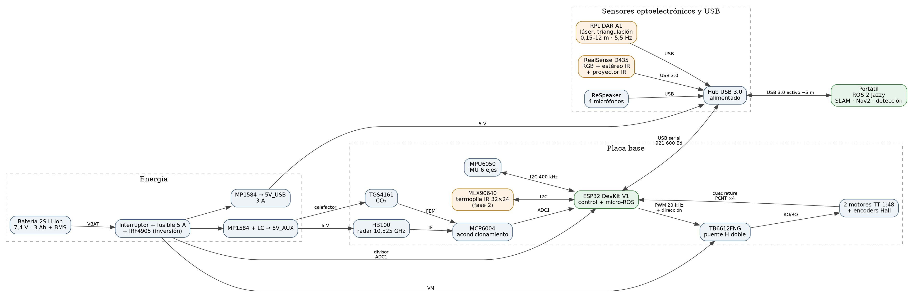

*Nota.* Elaboración propia. Los bloques naranjas son componentes optoelectrónicos; los verdes,
los dos procesadores.

### 3.1 Tabla de interfaces

**Tabla 4**
*Enlaces de la capa física*

| Origen → destino | Interfaz | Nivel eléctrico | Velocidad o tasa | Función |
|---|---|---|---|---|
| Batería → protección → VBAT | Potencia | 6,0–8,4 V | — | Energía de todo el robot |
| VBAT → MP1584 → 5V_USB | Potencia (reductor) | 5 V, hasta 2,1 A | — | Hub USB, LiDAR, cámara, micrófonos, ESP32 |
| VBAT → MP1584 + LC → 5V_AUX | Potencia filtrada | 5 V | — | Calefactor del CO₂, radar, encoders |
| VBAT → TB6612 → motores | PWM + puente H | 5,0 V efectivos máx. | 20 kHz | Tracción |
| Encoders → ESP32 | Cuadratura | 0 / 3,3 V | hasta 1,76 kHz por canal | Odometría |
| MPU6050, MLX90640 ↔ ESP32 | I2C | 0 / 3,3 V | 400 kHz | IMU y cámara térmica |
| TGS4161, HB100 → MCP6004 → ESP32 | Analógica | 0,15–2,45 V en el ADC | 1 Hz y 200 Hz | CO₂ y radar |
| Divisor → ESP32 | Analógica | 1,6–2,3 V | 1 Hz | Voltaje de batería |
| ESP32 ↔ hub | USB serial (micro-ROS) | USB 2.0 | 921 600 baudios | Tópicos de ROS 2 |
| LiDAR, cámara, micrófonos → hub | USB | USB 2.0 / 3.0 | — | Datos de sensores |
| Hub ↔ portátil | USB 3.0 activo (~5 m) | USB 3.0 | — | Un solo cable al computador |

*Nota.* Elaboración propia a partir de `robot_hw.yaml`.

Un **PWM** (modulación por ancho de pulso) enciende y apaga el motor muy rápido; la fracción de
tiempo encendido, llamada **ciclo de trabajo** o *duty*, fija el voltaje promedio. El bus **I2C**
es un bus de dos hilos (datos y reloj) por el que el ESP32 habla con varios sensores. Una señal en
**cuadratura** son dos pulsos desfasados que indican cuánto y hacia dónde gira la rueda.

### 3.2 Componentes optoelectrónicos

Un componente **optoelectrónico** convierte luz en señal eléctrica, o al revés. El robot tiene
tres:

- **LiDAR RPLiDAR A1.** Emite un haz láser y mide la distancia a lo que lo refleja mientras gira.
  Mide de 0,15 a 12 m, a 5,5 Hz de giro y 8 000 muestras por segundo (Shanghai Slamtec Co., Ltd.,
  s. f.). En el robot, su plano de escaneo queda a 0,145 m del suelo.
- **Cámara RealSense D435.** Combina una cámara de color con dos cámaras infrarrojas y un
  proyector de patrón infrarrojo; por estereoscopía calcula la profundidad de cada píxel
  (Intel Corporation, [VERIFICAR: año]).
- **Cámara térmica MLX90640.** Es una matriz de 32 × 24 **termopilas**, sensores que producen un
  voltaje proporcional a la radiación infrarroja que reciben. Así detecta el calor corporal
  (Melexis, [VERIFICAR: año]). Su conector queda listo en la placa para la fase 2.

Los tres llegan al computador o al ESP32 ya digitalizados, así que no necesitan
acondicionamiento analógico en la placa.

> **En resumen.** Once enlaces conectan energía, sensores y procesadores; los tres sensores
> ópticos entregan datos digitales por USB o I2C.

---

## 4. Esquemático en KiCad

El esquemático es el plano eléctrico de la placa base: muestra cada componente y cada conexión.
Si tiene un error, la placa fabricada lo tendrá también.

El esquemático lo genera un programa (`kicad/gen_schematic.py`) a partir del archivo de datos.
Cada pin termina en una **etiqueta de red**: todos los pines con la misma etiqueta están unidos.
La placa usa módulos (ESP32 DevKit, TB6612, GY-521, MP1584) sobre zócalos, para soldar a mano.

**Figura 2**
*Plano completo del esquemático (hoja A2)*

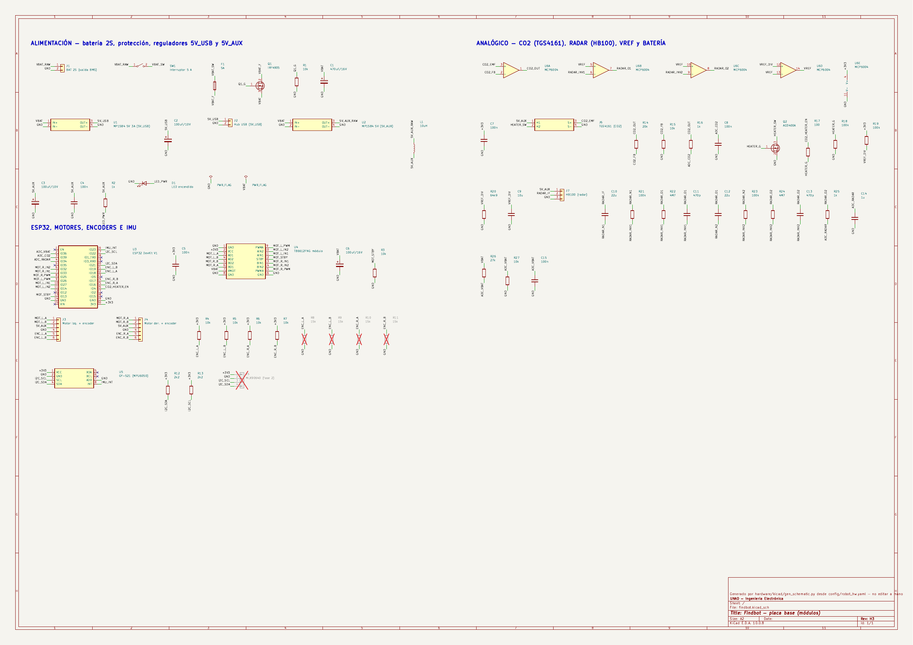

*Nota.* Elaboración propia con KiCad 10.0.8.

### 4.1 Bloques

- **Alimentación (Figura 3).** Conector XT30 de la batería, interruptor, fusible de 5 A, MOSFET
  IRF4905 contra inversión de polaridad, dos reguladores MP1584 y el filtro LC de 5V_AUX. Un
  **MOSFET** es un transistor que funciona como interruptor controlado por voltaje.
- **ESP32, motores, encoders e IMU (Figura 4).** El ESP32, el módulo TB6612, los conectores de
  motor con encoder, los pull-ups, el GY-521 y el conector de la cámara térmica. Una resistencia
  **pull-up** fija un nivel alto en una línea cuando nadie la lleva a cero.
- **Analógico (Figura 5).** El MCP6004 (cuatro amplificadores operacionales) para el CO₂, dos
  etapas del radar y la referencia de 1,30 V; el MOSFET del calefactor y el divisor de batería.

**Figura 3**
*Bloque de alimentación*

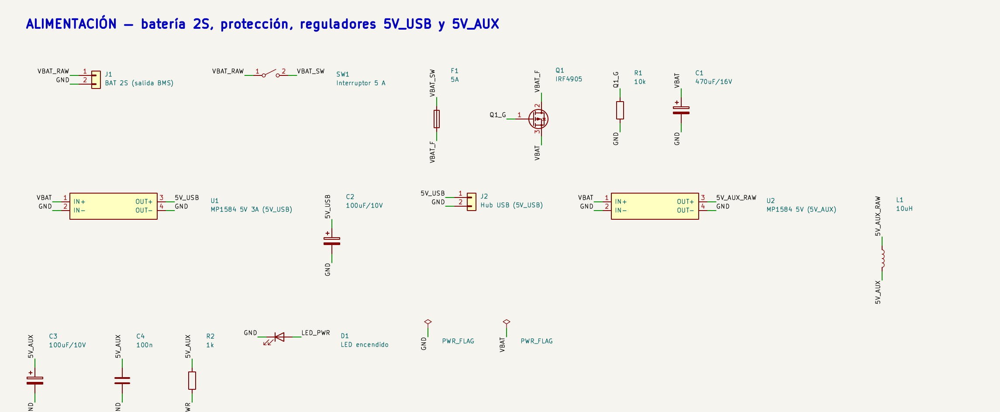

*Nota.* Elaboración propia con KiCad 10.0.8.

**Figura 4**
*Bloque del ESP32, motores, encoders e IMU*

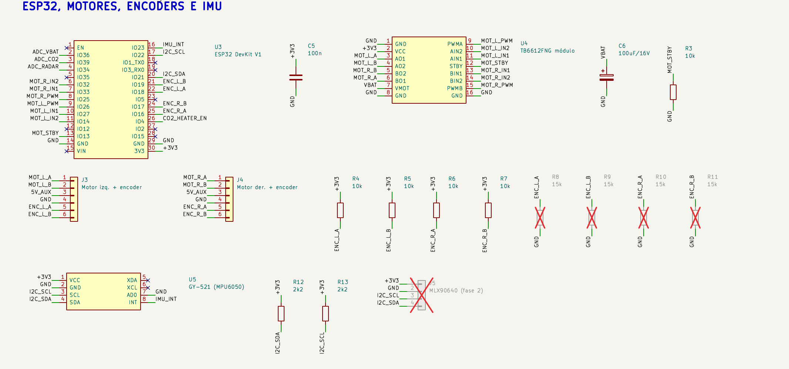

*Nota.* Elaboración propia con KiCad 10.0.8. Los componentes tachados se marcan "no montar".

**Figura 5**
*Bloque analógico*

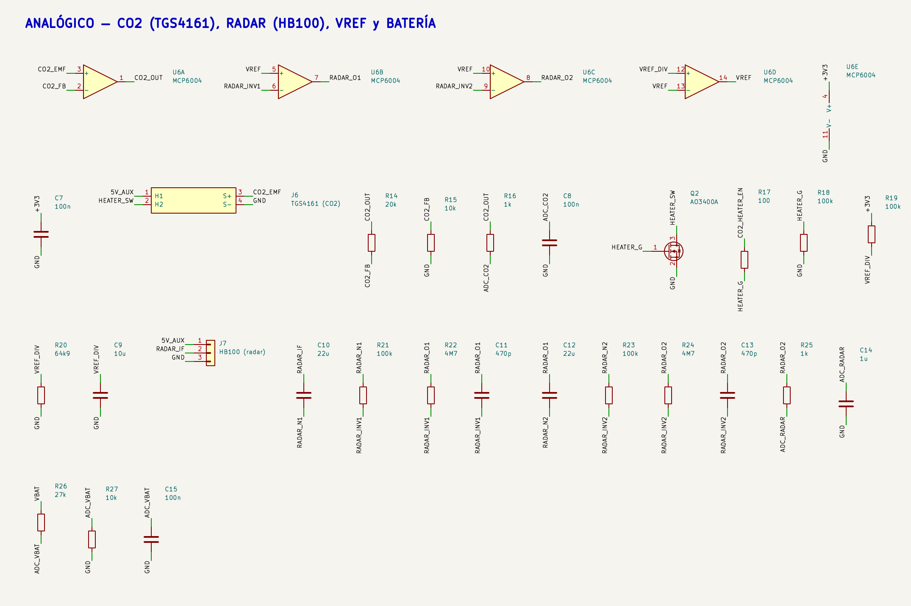

*Nota.* Elaboración propia con KiCad 10.0.8.

### 4.2 Verificación eléctrica (ERC)

El **ERC** (*Electrical Rules Check*) revisa errores como dos salidas unidas, pines de
alimentación sin fuente o pines sin conectar.

**Tabla 5**
*Resultado de la verificación del esquemático*

| Verificación | Resultado | Criterio | ¿Pasa? |
|---|---|---|---|
| ERC de KiCad | 0 errores, 0 advertencias | 0 errores | Sí |
| Netlist frente a la tabla de pines | 19 GPIO en su red, 0 discrepancias | 0 discrepancias | Sí |
| Valores frente a lo simulado | R14, R15, R21, R22, C10, C11, R26, R27, C15, R4 iguales | Iguales | Sí |
| Componentes y redes | 61 componentes, 47 redes | — | — |

*Nota.* Elaboración propia. Evidencia: `kicad/out/erc.rpt` y `kicad/check_netlist.py`.

> **En resumen.** El esquemático se genera desde los datos del robot y pasa la verificación
> eléctrica sin errores ni advertencias.

---

## 5. Simulación de circuitos y potencia (R1)

Esta sección comprueba con ngspice que cada etapa eléctrica entrega lo que el robot necesita.
Cada gráfica es un **osciloscopio virtual**: muestra cómo cambia un voltaje o una corriente en el
tiempo, como lo vería un osciloscopio real conectado a la placa.

Los valores de cada componente se leen del archivo de datos. Los modelos del MCP6004 y del
AO3400 son **modelos de comportamiento**, es decir, reproducen lo que dice la hoja de datos sin
copiar la estructura interna del chip (Microchip Technology Inc., 2020).

### 5.1 Alimentación

Se probó si el regulador de 5 V aguanta los momentos más exigentes: el arranque de los dos
motores y el consumo máximo de los equipos USB. Si el voltaje de 5 V cae por debajo de 4,75 V,
el LiDAR o la cámara pueden reiniciarse y el robot pierde su mapa.

**Circuito simulado.** Batería con resistencia interna de 0,10 Ω, fusible, MOSFET IRF4905 de
protección y un regulador reductor conmutado a 500 kHz con su lazo de control. Un **regulador
reductor** baja el voltaje encendiendo y apagando un interruptor y suavizando con una bobina y un
condensador. A 1 ms arrancan los motores (3,0 A) y a 2 ms la carga USB salta de 0,6 a 2,1 A.

**Parámetros.** Bobina de 4,7 µH, 44 µF de salida y lazo proporcional-integral. La bobina, el
condensador y el lazo son supuestos: el MP1584 tiene su propio control interno, que no se modeló.

**Figura 6**
*Alimentación con batería nominal (7,4 V)*

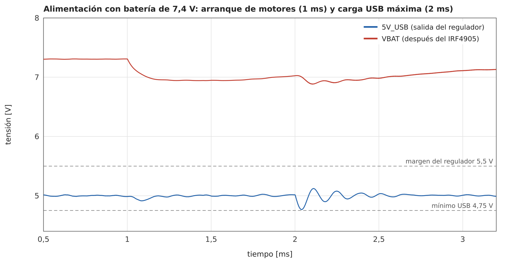

*Nota.* Elaboración propia con ngspice 42.

**Cómo leer la gráfica.** El eje horizontal es el tiempo en milisegundos y el vertical, el
voltaje. La línea azul es la salida de 5 V; la roja, la batería después del MOSFET. Las líneas
punteadas son los límites. Hay que fijarse en los dos valles: a 1 ms (motores) y a 2 ms (carga
USB). La línea azul nunca cruza 4,75 V, así que el voltaje se mantiene dentro del margen USB.

**Figura 7**
*Alimentación con batería crítica (6,2 V)*

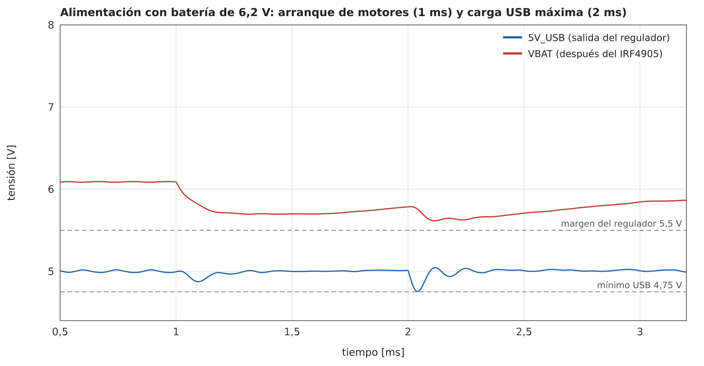

*Nota.* Elaboración propia con ngspice 42.

Con la batería en el umbral crítico, el arranque de los motores baja VBAT a 5,61 V. Aun así queda
por encima de 5,5 V, el margen que necesita el regulador para seguir entregando 5 V.

**Figura 8**
*Rizado de 5V_USB en régimen permanente*

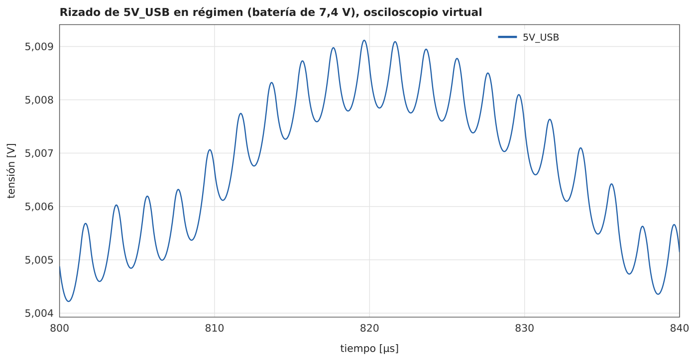

*Nota.* Elaboración propia con ngspice 42.

El **rizado** es la pequeña oscilación que deja la conmutación del regulador. En esta ampliación
de 40 µs se ven los ciclos de 500 kHz: la salida oscila unos 19 mV alrededor de 5,00 V.

**Tabla 6**
*Alimentación: criterio frente a resultado*

| Medición | Batería 8,4 V | Batería 7,4 V | Batería 6,2 V | Criterio | ¿Pasa? |
|---|---|---|---|---|---|
| 5 V en régimen | 5,002 V | 5,001 V | 5,003 V | 4,9–5,1 V | Sí |
| Rizado pico a pico | 30,5 mV | 19,3 mV | 33,1 mV | ≤ 50 mV | Sí |
| Mínimo de 5 V en los eventos | 4,758 V | 4,766 V | 4,755 V | ≥ 4,75 V (USB 2.0) | Sí |
| Mínimo de VBAT en los eventos | 7,919 V | 6,884 V | 5,614 V | ≥ 5,5 V | Sí |
| 5 V tras los eventos | 5,005 V | 5,004 V | 5,011 V | 4,9–5,1 V | Sí |

*Nota.* Elaboración propia. El mínimo de 4,75 V para VBUS se toma de la especificación USB 2.0
(USB Implementers Forum, [VERIFICAR: año]). Evidencia: `spice/power_supply.cir`,
`spice/results/summary.txt`.

El mínimo de 4,755 V queda solo 5 mV sobre el límite. Ese margen depende del lazo de control
supuesto, así que la caída real debe medirse en la placa con un osciloscopio.

### 5.2 Potencia: puente H y motor

Se probó si el puente H TB6612FNG aguanta la corriente de los motores, incluso con una rueda
trabada entre escombros. Si la corriente supera su límite por mucho tiempo, el chip se calienta y
se apaga, y el robot queda detenido.

Un **puente H** son cuatro interruptores que permiten hacer girar un motor en ambos sentidos. El
TB6612FNG tiene dos, con una resistencia de encendido de unos 0,5 Ω y límites de 1,2 A promedio y
3,2 A pico por canal (Toshiba, [VERIFICAR: año]).

**Circuito simulado.** Un canal del TB6612 a 20 kHz con frenado corto en el tiempo apagado, y un
modelo electromecánico del motor TT referido a la rueda. Sus parámetros salen de la ficha del
fabricante: 6 V nominales, 160 mA y 250 rpm sin carga, 1,5 A y 0,8 kg·cm con el rotor bloqueado
(Adafruit Industries, s. f.). De ahí se obtienen la resistencia (4 Ω), la constante de fuerza
contraelectromotriz (0,205 V·s/rad) y la constante de par efectiva.

La **fuerza contraelectromotriz** es el voltaje que genera el propio motor al girar; se opone al
de la batería y por eso la corriente baja cuando el motor toma velocidad.

**Figura 9**
*Arranque del motor a duty máximo*

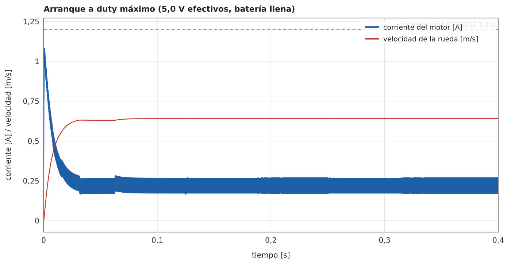

*Nota.* Elaboración propia con ngspice 42.

**Cómo leer la gráfica.** En el eje horizontal está el tiempo en segundos. La curva azul es la
corriente (A) y la roja, la velocidad de la rueda convertida a m/s. Al arrancar, la corriente
sube a un pico de 1,09 A y baja a unos 0,25 A cuando el motor alcanza velocidad. La velocidad se
estabiliza en 0,64 m/s, el doble de los 0,30 m/s que usa el robot.

**Figura 10**
*Corriente del motor en régimen: efecto del PWM*

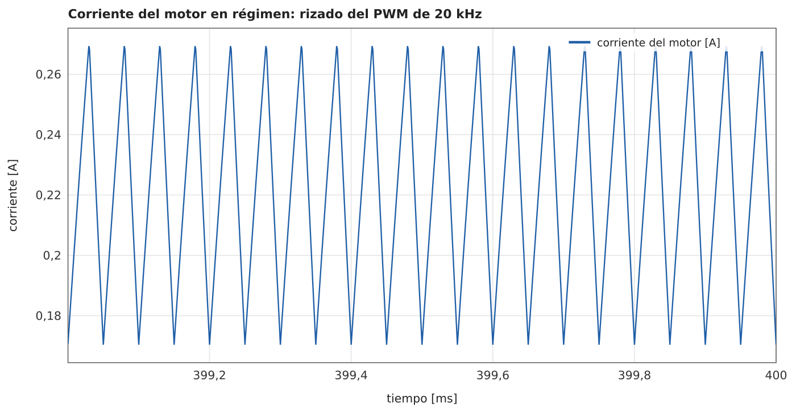

*Nota.* Elaboración propia con ngspice 42.

En esta ampliación de 1 ms se ve la corriente en dientes de sierra a 20 kHz: sube cuando el PWM
está encendido y baja en el frenado. La oscilación es de 99 mA pico a pico.

**Figura 11**
*Rueda bloqueada (peor caso de carga)*

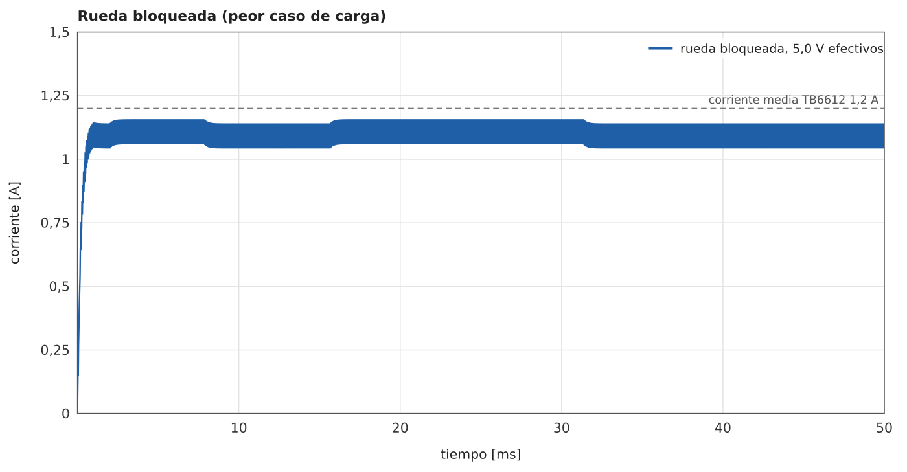

*Nota.* Elaboración propia con ngspice 42.

Con la rueda bloqueada no hay fuerza contraelectromotriz y la corriente solo la limitan las
resistencias. Se estabiliza en 1,09 A, por debajo de la línea de 1,2 A.

**Tabla 7**
*Potencia: criterio frente a resultado*

| Medición | Resultado | Criterio | ¿Pasa? |
|---|---|---|---|
| Pico de corriente al arrancar | 1,085 A | ≤ 3,2 A | Sí |
| Corriente con rueda bloqueada | 1,093 A | ≤ 1,2 A | Sí (tras la corrección C1) |
| Voltaje medio en el motor | 4,91 V | ≤ 5,1 V | Sí |
| Velocidad máxima del robot | 0,641 m/s | ≥ 0,30 m/s | Sí |
| Rizado de corriente a 20 kHz | 99 mA | ≤ 200 mA | Sí |

*Nota.* Elaboración propia. Evidencia: `spice/motor_drive.cir`. La corrección C1 se explica en la
sección 7.5.

### 5.3 Acondicionamiento de señales

**Acondicionar** una señal es adaptarla para que el ADC la lea bien: ampliarla, filtrarla o
llevarla al rango correcto. Si no se hace, el ESP32 leería una batería equivocada, no notaría el
CO₂ de una víctima o confundiría ruido con respiración.

El ADC del ESP32 con atenuación de 11 dB solo es fiable entre 150 y 2 450 mV (Espressif Systems,
2026, p. 44). Una **atenuación** reduce el voltaje de entrada para ampliar el rango que el ADC
puede medir. Ese rango se usa como criterio en todo lo que sigue.

**a) Divisor de batería.** Dos resistencias (27 kΩ y 10 kΩ) reducen la batería a un voltaje que
el ADC acepta, y un condensador de 100 nF filtra el ruido.

**Figura 12**
*Divisor de batería: voltaje en el ADC según el voltaje de batería*

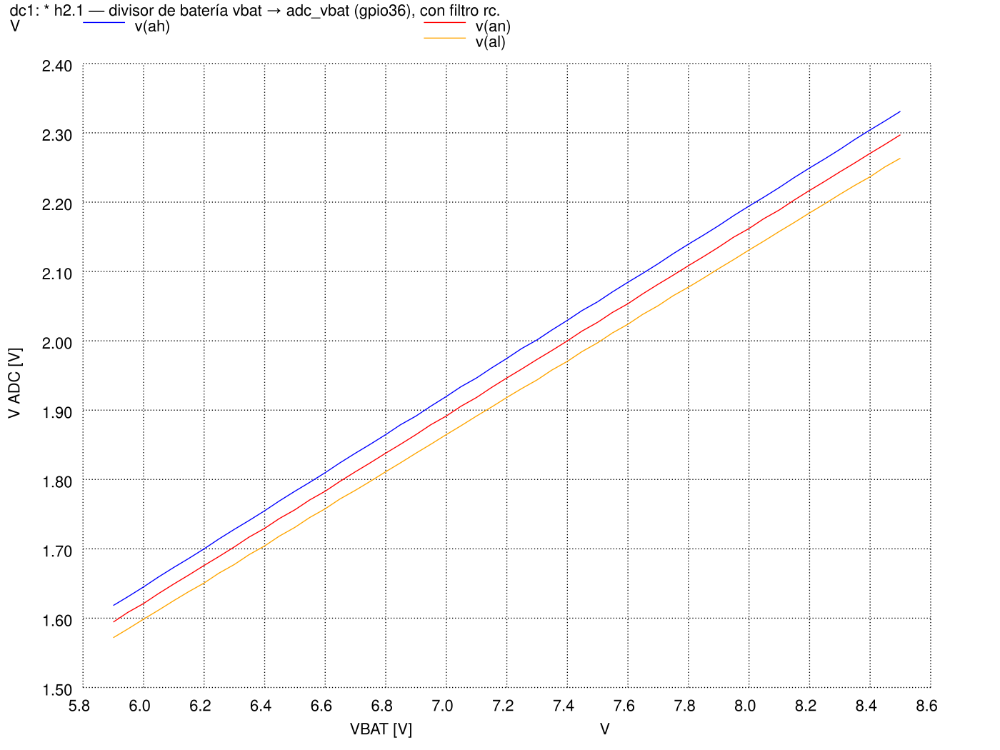

*Nota.* Elaboración propia con ngspice 42.

En el eje horizontal está la batería (5,9–8,5 V) y en el vertical, el voltaje que llega al ADC.
Las tres rectas son el valor nominal y los dos peores casos con resistencias de ±1 %. Con la
batería llena, el peor caso llega a 2,30 V, por debajo de 2,45 V.

**b) Amplificador del CO₂.** El TGS4161 entrega entre 0,2 y 0,5 V, pero casi no puede dar
corriente. Un amplificador no inversor de ganancia 3, con un MCP6004 cuya corriente de entrada es
de 1 pA (Microchip Technology Inc., 2020), lo lleva al rango del ADC sin cargar al sensor
(Figaro Engineering, [VERIFICAR: año]).

**Figura 13**
*Amplificador del CO₂*

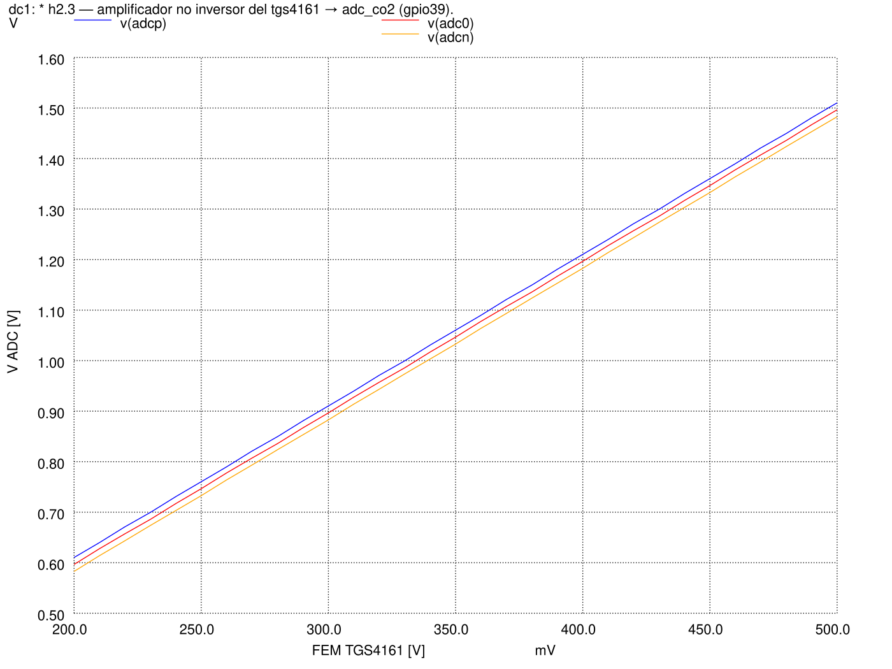

*Nota.* Elaboración propia con ngspice 42.

El eje horizontal es la tensión del sensor y el vertical, la salida hacia el ADC. Las tres rectas
incluyen el offset máximo del amplificador (±4,5 mV) en cada sentido. Todas quedan entre 0,58 y
1,51 V. El **offset** es el pequeño error de voltaje propio del amplificador.

**c) Amplificador del radar.** La señal del HB100 es de microvoltios ([VERIFICAR: fabricante del HB100], [VERIFICAR: año]). Dos etapas la amplifican unas 2 200 veces y solo dejan pasar de 0,1 a 45 Hz,
la banda de la respiración y del movimiento de una persona.

**Figura 14**
*Respuesta en frecuencia del amplificador del radar (diagrama de Bode)*

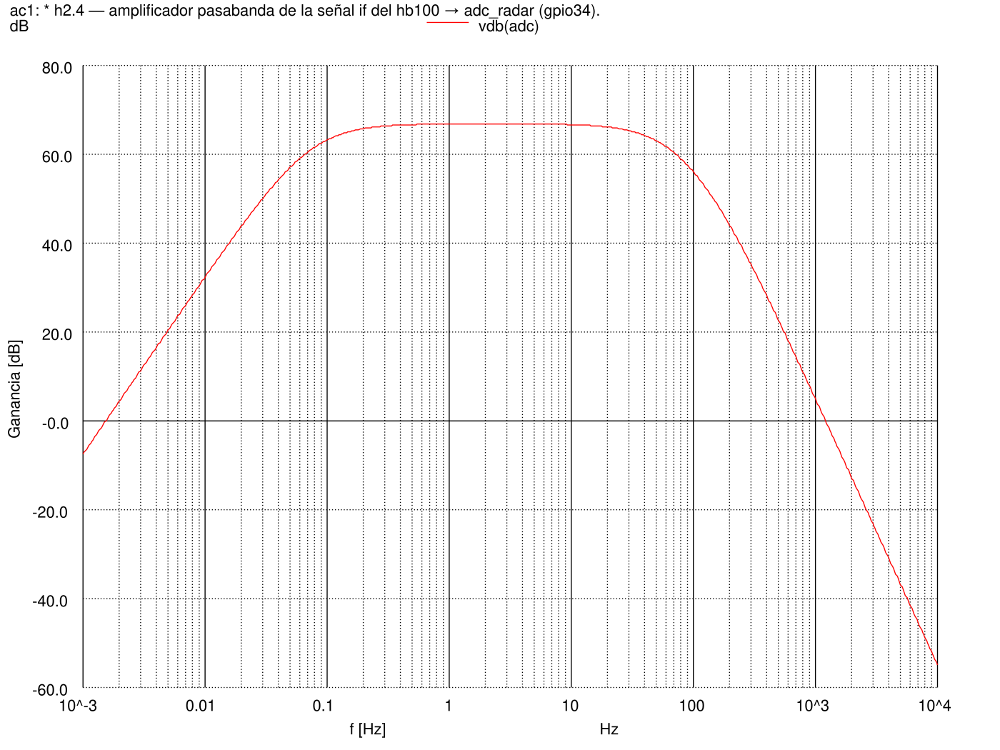

*Nota.* Elaboración propia con ngspice 42.

Un **diagrama de Bode** muestra cuánto amplifica un circuito cada frecuencia. El eje horizontal es
la frecuencia en escala logarítmica y el vertical, la ganancia en decibeles. La meseta de 66,8 dB
entre 0,11 y 43 Hz es la banda útil; fuera de ella la ganancia cae, lo que rechaza el ruido.

**Figura 15**
*Señal del radar amplificada en el tiempo*

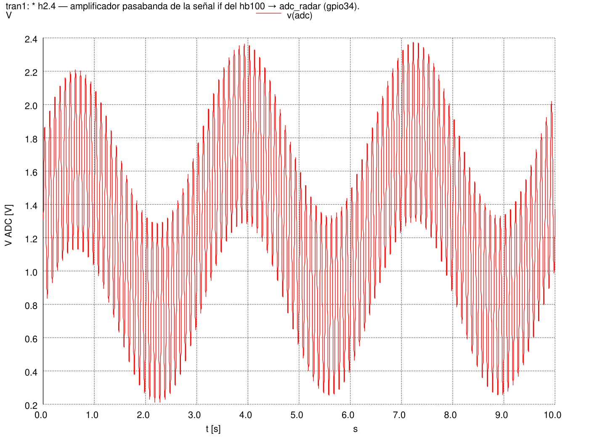

*Nota.* Elaboración propia con ngspice 42.

Se aplicaron dos señales de 0,25 mV: una lenta de 0,3 Hz (respiración) y otra de 10 Hz
(movimiento). La salida oscila entre 0,21 y 2,37 V alrededor de 1,30 V, dentro del rango fiable
del ADC.

**Tabla 8**
*Acondicionamiento: criterio frente a resultado*

| Etapa | Medición | Resultado | Criterio | ¿Pasa? |
|---|---|---|---|---|
| Divisor | ADC con 8,4 V, peor caso | 2,304 V | ≤ 2,45 V | Sí |
| Divisor | ADC con 6,0 V, peor caso | 1,598 V | ≥ 0,15 V | Sí |
| Divisor | Resolución en batería | 2,98 mV | ≤ 10 mV | Sí |
| Divisor | Asentamiento al 99 % | 3,36 ms | ≤ 5 ms | Sí |
| CO₂ | Ganancia | 3,00 | 2,97–3,03 | Sí |
| CO₂ | Salida mínima y máxima | 0,583–1,510 V | 0,15–1,75 V | Sí |
| CO₂ | Error de carga sobre el sensor | 1,0 mV | ≤ 2 mV | Sí |
| Radar | Ganancia en la banda | 66,84 dB | 63–69 dB | Sí |
| Radar | Corte inferior y superior | 0,112 y 43,47 Hz | 0,08–0,15 y 35–70 Hz | Sí |
| Radar | Reposo de la salida | 1,308 V | 1,25–1,35 V | Sí |
| Radar | Salida máxima y mínima | 2,373 y 0,209 V | ≤ 2,45 y ≥ 0,15 V | Sí (tras la corrección C3) |
| Calefactor | Voltaje en el calefactor | 4,998 V | 4,8–5,2 V | Sí |
| Calefactor | Disipación del AO3400 | 0,10 mW | ≤ 50 mW | Sí |

*Nota.* Elaboración propia. El AO3400A tiene un umbral típico de 1,05 V y menos de 48 mΩ con 2,5 V
de puerta (Alpha and Omega Semiconductor, [VERIFICAR: año]), por eso 3,3 V del ESP32 lo encienden
de lleno.

### 5.4 Acoplamiento entre etapas

**Acoplar** es conectar la salida de una etapa con la entrada de otra respetando niveles y
tiempos. Si el acoplamiento falla, el ESP32 pierde pulsos del encoder o recibe datos corruptos de
la IMU.

**a) Encoders.** Las salidas Hall llegan al ESP32 con pull-ups a 3,3 V. El ESP32 lee "1" desde
0,75·VDD y "0" hasta 0,25·VDD (Espressif Systems, 2026, p. 52).

**Figura 16**
*Pulsos del encoder en el pin del ESP32*

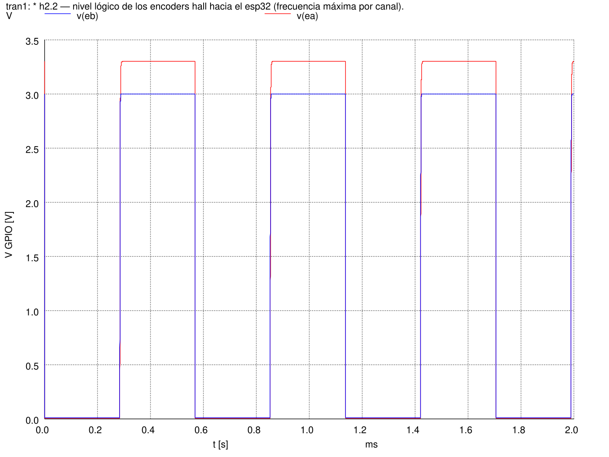

*Nota.* Elaboración propia con ngspice 42.

La curva roja (salida de colector abierto con 10 kΩ) sube a 3,3 V; la azul (módulo con pull-up
propio a 5 V y 15 kΩ a tierra) sube a 3,0 V. Ambas bajan a casi 0 V y suben en menos de 2,5 µs:
son niveles y flancos válidos.

**b) Bus I2C.** La norma I2C exige que, en modo rápido (400 kHz), la línea suba del 30 % al 70 %
en 300 ns o menos (NXP Semiconductors, 2021, p. 44). El **tiempo de subida** depende de la
resistencia pull-up y de la capacidad del bus.

**Figura 17**
*Subida de la línea SDA del bus I2C*

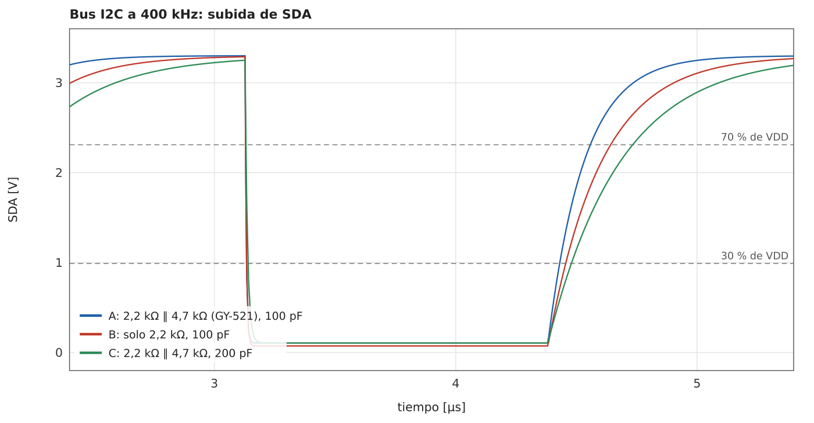

*Nota.* Elaboración propia con ngspice 42.

Las tres curvas son tres situaciones del bus. Las líneas punteadas marcan el 30 % y el 70 % de
3,3 V. Cuanto más rápido cruza una curva de una línea a la otra, mejor: las tres lo hacen en menos
de 300 ns con los pull-ups de 2,2 kΩ.

**Tabla 9**
*Acoplamiento: criterio frente a resultado*

| Medición | Resultado | Criterio | ¿Pasa? |
|---|---|---|---|
| Encoder caso A: alto / bajo / subida | 3,30 V / 0,007 V / 2,31 µs | ≥ 2,5 V / ≤ 0,8 V / ≤ 5 µs | Sí |
| Encoder caso B: alto / bajo / subida | 3,00 V / 0,010 V / 1,38 µs | ≥ 2,5 V / ≤ 0,8 V / ≤ 5 µs | Sí |
| I2C caso A (placa ∥ GY-521, 100 pF) | 127 ns | ≤ 300 ns | Sí |
| I2C caso B (solo la placa, 100 pF) | 186 ns | ≤ 300 ns | Sí (tras la corrección C2) |
| I2C caso C (con MLX90640, 200 pF) | 254 ns | ≤ 300 ns | Sí (tras la corrección C2) |
| I2C nivel bajo | 0,107 V | ≤ 0,825 V | Sí |

*Nota.* Elaboración propia. Evidencia: `spice/encoder_level.cir` y `spice/i2c_bus.cir`.

> **En resumen.** Las cuatro etapas cumplen sus 48 criterios, pero solo después de tres
> correcciones que la propia simulación reveló (sección 7.5).

---

## 6. Emulación del firmware (R2)

Esta sección comprueba que el programa del ESP32 hace lo que debe, sin tener la placa. Un error
aquí es grave: por ejemplo, si el programa no detiene los motores al perder la comunicación, el
robot seguiría avanzando sin control.

El **firmware** es el programa que corre dentro del microcontrolador. Se verificó en tres niveles:
pruebas unitarias en el computador, emulación del lazo de control y emulación completa en Wokwi.

### 6.1 Máquinas de estados y diagrama de flujo

Una **máquina de estados** es un modelo en el que el sistema está siempre en uno de varios
estados y cambia de uno a otro por eventos definidos. El firmware tiene dos.

**Figura 18**
*Máquina de estados de la tracción*

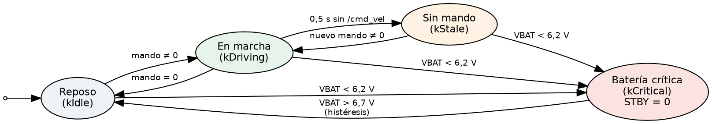

*Nota.* Elaboración propia a partir de `firmware/src/main.cpp`.

La batería crítica tiene prioridad sobre todo: desde cualquier estado lleva a "Batería crítica",
que apaga el puente H. Para salir se exige subir hasta 6,7 V, no solo pasar de 6,2 V; esa
diferencia se llama **histéresis** y evita que el robot se encienda y apague repetidamente.

**Figura 19**
*Máquina de estados de la conexión con el agente micro-ROS*

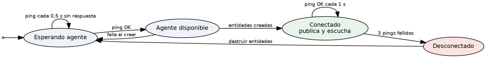

*Nota.* Elaboración propia a partir de `firmware/src/ros_bridge.cpp`.

El **agente micro-ROS** es el programa del computador que traduce entre el ESP32 y ROS 2. Esta
máquina corre en el núcleo 0 del ESP32; el control corre en el núcleo 1, así que una espera de
comunicación nunca congela los motores.

**Figura 20**
*Diagrama de flujo del lazo de control (50 Hz)*

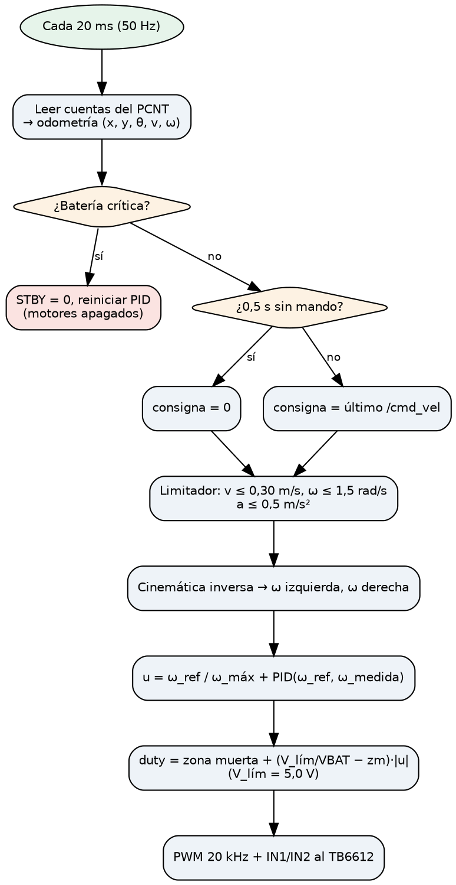

*Nota.* Elaboración propia a partir de `firmware/src/main.cpp`.

Un **PID** (proporcional-integral-derivativo) es un controlador que corrige la velocidad según el
error actual, el acumulado y su tendencia. La **zona muerta** es el ciclo de trabajo mínimo por
debajo del cual el motor no vence la fricción.

### 6.2 Pruebas unitarias

La lógica del firmware (PID, cinemática, odometría, límite del PWM, batería, vigilante de
comandos y conversiones de ROS) está separada del hardware y se compila en el computador. La
**odometría** estima la posición del robot a partir de las vueltas de las ruedas.

**Tabla 10**
*Pruebas unitarias del firmware (Unity, PlatformIO)*

| Grupo | Pruebas | Qué verifican | Resultado |
|---|---|---|---|
| Control | 14 | PID, protección contra saturación, convergencia en lazo cerrado, límite del PWM, vigilante | 14/14 |
| Cinemática | 11 | Recta, giro en el lugar, límites, odometría de 1 m, media vuelta y arco de 90° | 11/11 |
| Sensores | 10 | Batería con histéresis, IMU, CO₂, RMS del radar, referencia de 1,30 V | 10/10 |
| ROS | 8 | Cuaternión, covarianzas, hora, salud de batería, nombres de tópicos, uso del enlace | 8/8 |
| **Total** | **43** | | **43/43** |

*Nota.* Elaboración propia. Evidencia: `pio test -e native` en `hardware/firmware/`.

### 6.3 Emulación del lazo de control

Se ejecutó el código real del controlador contra un modelo del motor TT, el mismo de la sección
5.2. Así se ve si el robot alcanza la velocidad pedida, si se pasa o si tarda demasiado. Un PID
mal ajustado haría que el robot oscile o choque contra los escombros.

**Figura 21**
*Respuesta de la velocidad del robot a un mando de 0,30 m/s*

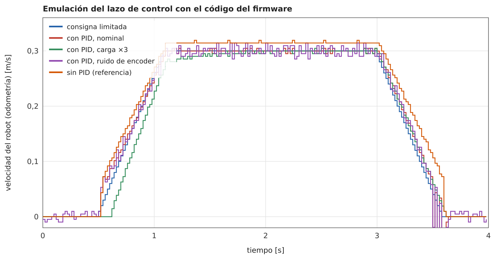

*Nota.* Elaboración propia. Emulación con `firmware/tools/run_control_sim.py`.

**Cómo leer la gráfica.** El eje horizontal es el tiempo y el vertical, la velocidad que mide la
odometría. La curva azul es la consigna: sube en rampa porque el firmware limita la aceleración a
0,5 m/s². Las curvas con PID siguen la rampa y se quedan en 0,30 m/s. La naranja (sin PID) se
queda en 0,314 m/s: sin corrección, el robot va 5 % más rápido de lo pedido.

**Tabla 11**
*Emulación del lazo de control: esperado frente a obtenido*

| Escenario | Velocidad final | Error | Sobrepaso | Establecimiento | ¿Pasa? |
|---|---|---|---|---|---|
| Nominal (7,4 V) | 0,300 m/s | 0,0 % | 1,5 % | 0,58 s | Sí |
| Batería baja (6,3 V) | 0,300 m/s | 0,0 % | 1,5 % | 0,58 s | Sí |
| Carga triple | 0,299 m/s | 0,2 % | 1,5 % | 0,70 s | Sí |
| Ruido de ±2 cuentas en el encoder | 0,300 m/s | 0,0 % | 4,7 % | 0,56 s | Sí |
| Sin PID (referencia) | 0,314 m/s | 4,8 % | 6,4 % | 2,34 s | — |
| **Criterio** | | ≤ 3 % | ≤ 10 % | ≤ 1,2 s | |

*Nota.* Elaboración propia. El **sobrepaso** es cuánto se pasa la velocidad del valor pedido; el
**tiempo de establecimiento**, cuánto tarda en quedar dentro de ±5 %.

### 6.4 Emulación en Wokwi

Wokwi ejecutó el binario real del firmware sobre un ESP32 simulado, con un MPU6050, botones que
imitan los encoders, potenciómetros que imitan las entradas analógicas y un **analizador lógico**,
un instrumento que registra los niveles de varias señales digitales en el tiempo.

**Tabla 12**
*Escenario automático de Wokwi (111 pasos): esperado frente a obtenido*

| Prueba | Resultado esperado | Resultado obtenido | ¿Pasa? |
|---|---|---|---|
| Arranque | `IMU ok` y cabecera de telemetría | `# findbot firmware \| IMU ok \| bateria 8.25 V` | Sí |
| Calefactor | GPIO4 = 1 con `h 1` | GPIO4 = 1 | Sí |
| Mando de avance | PWM a 20 kHz; STBY = 1; izquierdo IN1/IN2 = 1/0; derecho = 0/1 | `# motores ON pwm=20000 Hz`; niveles correctos | Sí |
| Vigilante | A los 0,5 s sin mando, IN1 = IN2 = 0 | `# vigilante: sin mando, motores a 0`; niveles en 0 | Sí |
| IMU | Giro de 90 °/s → 1,57 rad/s | `imu_gz=1.57` | Sí |
| Encoders | 5 ciclos de cuadratura por rueda → 20 y −20 cuentas | `enc_l=20 enc_r=-20`, `theta=-0.020` | Sí |
| Batería crítica | STBY = 0 bajo 6,2 V | `# motores OFF: bateria critica`; STBY = 0 | Sí |
| Recuperación | Aviso al superar 6,7 V | `# bateria recuperada` | Sí |

*Nota.* Elaboración propia. Corrida del 20 de noviembre de 2026, 16:44, superada. Evidencia:
`docs/evidencia/wokwi_h5_serial_2026-11-20_1644.log`.

Extracto del registro serial de esa corrida:

```text
# findbot firmware | IMU ok | bateria 8.25 V
# motores ON pwm=20000 Hz
# vigilante: sin mando, motores a 0
# estado imu_gz=1.57 bat=8.25 nivel=0 motores=1 x=0.000 theta=-0.020 enc_l=20 enc_r=-20
# motores OFF: bateria critica
# bateria recuperada
```

### 6.5 Emulación del enlace micro-ROS y captura del analizador lógico

Se conectó el ESP32 simulado al agente micro-ROS real y se consultaron los tópicos desde ROS 2.
En las corridas superadas se verificaron los seis tópicos con sus tipos, los frames `odom` →
`base_footprint` e `imu_link`, los nombres de las ruedas, una aceleración vertical de
9,8067 m/s² y la hora sincronizada.

Esas salidas se registraron en la bitácora de la sesión, pero sus archivos de texto fueron
sobrescritos por una corrida posterior que no arrancó porque se agotó la cuota gratuita de Wokwi.
Solo se conserva la traza del analizador lógico.

**Figura 22**
*Traza del analizador lógico durante la prueba micro-ROS*

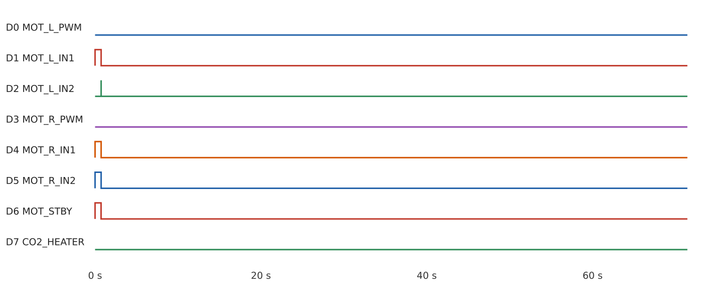

*Nota.* Elaboración propia con Wokwi. Evidencia:
`docs/evidencia/wokwi_microros_e2e_2026-11-20_1648.vcd`.

**Cómo leer la traza.** Cada fila es una señal hacia el TB6612. STBY (D6) vale 1 solo en el
instante 0, que es el estado de encendido del simulador. A los 0,73 s el firmware lo pone en 0 y
no vuelve a subir.

Por lo tanto, **esta traza no demuestra que un mando `/cmd_vel` enviado desde ROS 2 haya
encendido los motores**. La verificación automática original contaba ese 1 del instante 0 como
éxito; era un falso positivo y fue corregida. Esta prueba queda pendiente (sección 9.3).

> **En resumen.** La lógica, el lazo de control y el firmware completo en Wokwi pasan todas sus
> pruebas; falta repetir la prueba de `/cmd_vel` a motores por micro-ROS.

---

## 7. Pruebas de estrés (R3)

Una prueba de estrés lleva el diseño a condiciones peores que las normales: componentes fuera de
su valor exacto, frío, calor, ruido o carga máxima. Busca lo que fallaría en el campo, no en el
laboratorio.

### 7.1 Carga

Las condiciones de carga máxima ya se simularon en la sección 5: arranque de los dos motores con
consumo USB máximo y batería crítica (Tabla 6), rueda bloqueada (Tabla 7), carga triple en el
lazo de control (Tabla 11) y bus I2C cargado con la cámara térmica (Tabla 9). Todas pasan con las
correcciones de la sección 7.5.

### 7.2 Ruido

**Ruido** es cualquier señal no deseada que se suma a la útil. Se probaron dos casos: el PWM de
los motores contaminando la batería, y ruido a la entrada del radar.

**Figura 23**
*Radar con ruido blanco en la entrada*

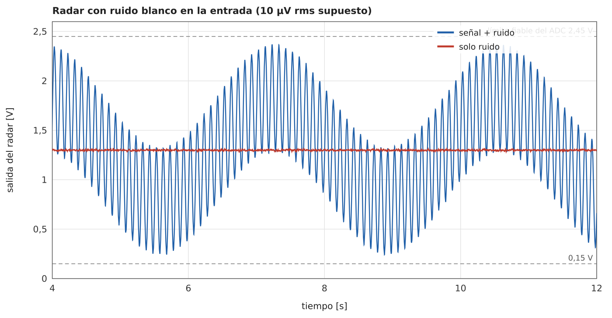

*Nota.* Elaboración propia con ngspice 42. El ruido de 10 µV rms es un supuesto, no un dato del
HB100.

La curva roja es solo ruido y la azul, señal más ruido. La señal se distingue con claridad y no
toca los límites del ADC. La **relación señal/ruido** (SNR) compara la potencia de la señal con
la del ruido; aquí es de 43,7 dB, es decir, la señal es unas 150 veces mayor en amplitud.

### 7.3 Monte Carlo

El método de **Monte Carlo** repite una simulación muchas veces, sorteando cada valor de
componente dentro de su **tolerancia**, el margen de fabricación que da el fabricante. Si todas
las corridas cumplen, el circuito funcionará con cualquier lote de componentes.

Se hicieron 300 corridas con semilla fija (reproducibles), resistencias de ±1 % y condensadores
de ±10 %, ambos como 3σ de una distribución normal.

**Figura 24**
*Monte Carlo: divisor de batería*

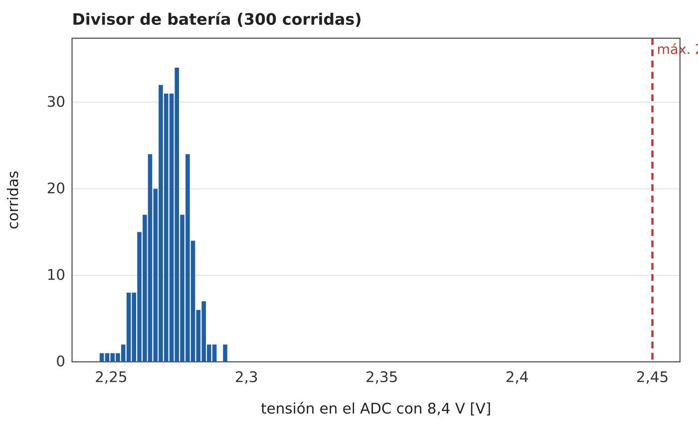

*Nota.* Elaboración propia con ngspice 42.

**Cómo leer un histograma.** Cada barra cuenta cuántas de las 300 corridas dieron un valor en ese
intervalo. La línea roja es el límite. Todas las barras quedan a la izquierda de 2,45 V: ningún
lote de resistencias satura el ADC.

**Figura 25**
*Monte Carlo: ganancia del amplificador del CO₂*

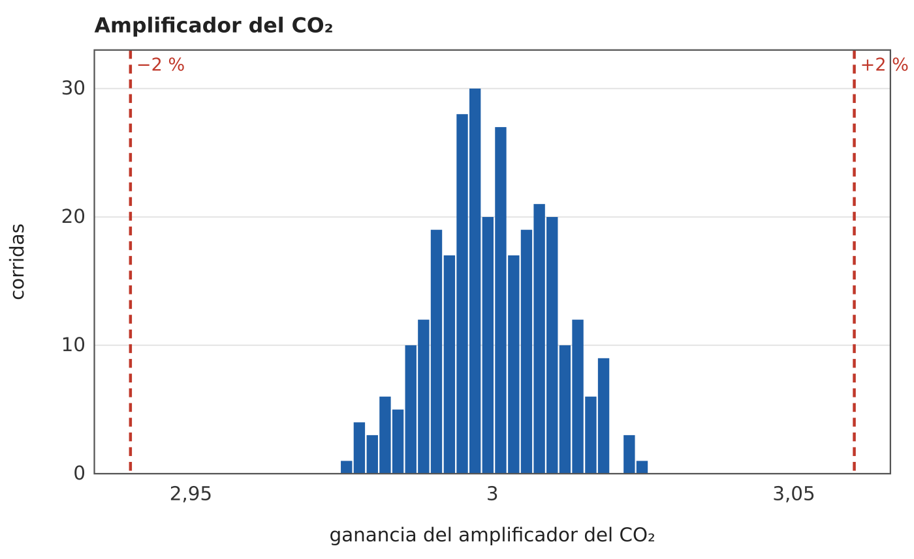

*Nota.* Elaboración propia con ngspice 42.

**Figura 26**
*Monte Carlo: corte superior del radar*

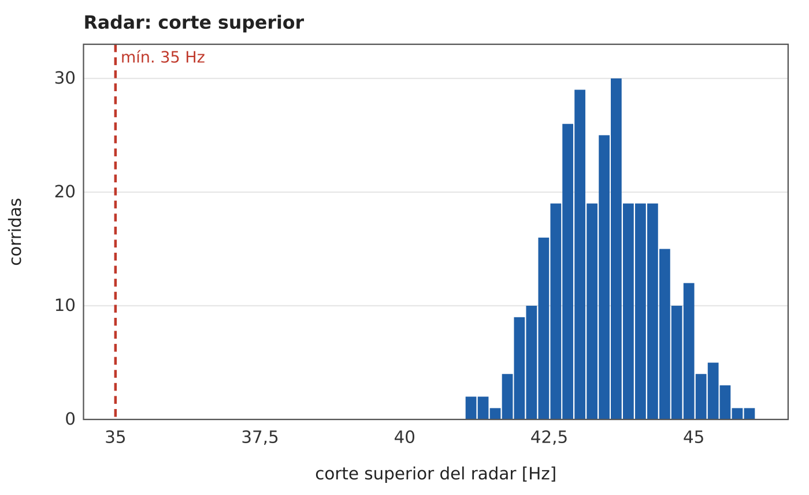

*Nota.* Elaboración propia con ngspice 42.

### 7.4 Temperatura

Se simuló a −10, 25 y 60 °C. Se tomó el peor caso: en cada par de resistencias que forma una
razón, los coeficientes térmicos van en sentidos opuestos (±100 ppm/°C, supuesto). El MCP6004
incluye su **deriva térmica** de offset de ±2 µV/°C (Microchip Technology Inc., 2020), es decir,
cuánto cambia su error con la temperatura.

**Tabla 13**
*Pruebas de estrés: criterio frente a resultado*

| Prueba | Medición | Resultado | Criterio | ¿Pasa? |
|---|---|---|---|---|
| Ruido | Rizado del PWM visto por el ADC de batería | 2,64 mV pico a pico | ≤ 5 mV | Sí |
| Ruido | SNR del radar | 43,7 dB | ≥ 20 dB | Sí |
| Ruido | Radar con ruido: máximo y mínimo | 2,37 y 0,24 V | ≤ 2,45 y ≥ 0,15 V | Sí |
| Monte Carlo | Divisor: máximo en el ADC | 2,293 V | ≤ 2,45 V | Sí |
| Monte Carlo | Ganancia del CO₂ | 2,975–3,026 | 2,94–3,06 | Sí |
| Monte Carlo | Ganancia del radar | 66,68–66,99 dB | 63–69 dB | Sí |
| Monte Carlo | Reposo del radar | 1,286–1,308 V | 1,25–1,35 V | Sí |
| Monte Carlo | Cortes del radar | ≤ 0,121 Hz y ≥ 41,1 Hz | ≤ 0,15 y ≥ 35 Hz | Sí |
| Temperatura | Error de lectura de batería (−10 y 60 °C) | +45,4 y −40,4 mV | ±50 mV | Sí |
| Temperatura | Error del CO₂ (−10 y 60 °C) | −1,82 y +1,58 mV | ±5 mV | Sí |
| Temperatura | Referencia del radar (−10 y 60 °C) | 1,305 y 1,294 V | 1,25–1,35 V | Sí |
| Temperatura | Calefactor (−10 y 60 °C) | 4,998 V | 4,8–5,2 V | Sí |

*Nota.* Elaboración propia. Evidencia: `spice/stress_noise.cir`, `spice/stress_mc.cir`,
`spice/stress_temp.cir` y `spice/results/summary.txt` (72 criterios en total, 0 fallas).

### 7.5 Correcciones al diseño

Las pruebas de estrés y de potencia encontraron cuatro problemas. Cada uno se corrigió en el
archivo de datos y todas las simulaciones se repitieron.

**Tabla 14**
*Correcciones al diseño producidas por la validación virtual*

| # | Problema encontrado | Evidencia | Corrección | Resultado tras corregir |
|---|---|---|---|---|
| C1 | Con 6 V efectivos, la rueda bloqueada pedía 1,31 A, más que los 1,2 A promedio del TB6612 | Simulación del motor bloqueado | El firmware limita el voltaje del motor a 5,0 V (`firmware.motor_v_limit`) | 1,09 A; el robot aún llega a 0,64 m/s |
| C2 | Sin los pull-ups del GY-521, o con la cámara térmica, la subida I2C era de 398 ns (> 300 ns) | Simulación del bus I2C | Pull-ups de la placa de 4,7 kΩ a 2,2 kΩ | 186 y 254 ns |
| C3 | La salida del radar llegaba a 2,72 V, fuera del rango fiable del ADC | Hoja de datos del ESP32, p. 44 | Referencia de 1,65 V a 1,30 V (divisor 100 kΩ / 64,9 kΩ) | 0,21–2,37 V |
| C4 | El diseño suponía 1,2 A de paro del motor; el fabricante indica 1,5 A a 6 V | Ficha de Adafruit (s. f.) | Dato corregido en `robot_hw.yaml` | Usado en C1 |

*Nota.* Elaboración propia.

Además, la verificación encontró dos errores del firmware antes de esta fase: la interrupción de
desbordes de los encoders no se registraba, por el orden de inicialización, y la espera al agente
micro-ROS podía bloquear el control. Ambos se corrigieron.

> **En resumen.** El diseño corregido aguanta tolerancias, temperatura, ruido y carga máxima; las
> pruebas cambiaron tres valores del diseño y un dato del motor.

---

## 8. Lista de materiales

Esta lista estima cuánto cuesta construir el robot. Sirve para pedir presupuesto y para decidir
qué sensores comprar primero.

**Tabla 15**
*Costo estimado del robot por grupo*

| Grupo | MVP (COP) | Fase 2 (COP) |
|---|---:|---:|
| Placa base (componentes y PCB) | 137 000 | 0 |
| Tracción (motores, ruedas, rueda loca) | 68 000 | 0 |
| Energía (celdas, BMS, cargador) | 92 000 | 0 |
| Sensores USB (LiDAR y cámara) | 1 652 000 | 0 |
| Enlace (hub y cable USB activo) | 120 000 | 0 |
| Mecánica (chasis y cableado) | 92 000 | 0 |
| Signos de vida (térmica, CO₂, radar, micrófonos) | 0 | 728 000 |
| **Total** | **≈ 2 161 000** | **≈ 728 000** |

*Nota.* Elaboración propia. Precios **aproximados** de noviembre de 2026 en USD convertidos con
una tasa de referencia de 4 000 COP por USD, sin envío ni impuestos. Deben confirmarse con
proveedores antes de comprar. Detalle por componente: `bom/bom_costos.csv`.

La cámara RealSense D435 es el 43 % del costo total. La tabla de sensores admite una Orbbec Astra
como alternativa más económica.

> **En resumen.** El robot completo cuesta unos 2,9 millones de COP, de los cuales 2,2 millones
> corresponden al MVP.

---

## 9. Conclusiones, limitaciones y trabajo futuro

### 9.1 Conclusiones

1. El hardware cumple los cuatro requisitos en simulación: 72 criterios eléctricos, 43 pruebas
   unitarias, 4 escenarios del lazo de control y el escenario de 111 pasos en Wokwi, sin fallas.
2. La validación virtual encontró problemas reales antes de fabricar: sobrecorriente con la rueda
   bloqueada, un bus I2C lento y una señal del radar fuera del rango del ADC.
3. El controlador PID del firmware corrige el error de la estimación previa (de 4,8 % a 0 %) y
   tolera batería baja, carga triple y ruido en el encoder.
4. Tener un único archivo de datos evitó inconsistencias: cada corrección se propagó sola al
   esquemático, al firmware y a las simulaciones.

### 9.2 Limitaciones frente al hardware real

- **Modelos supuestos.** El lazo del regulador, la inductancia y la inercia del motor, la
  rodadura, la capacidad del bus I2C y el ruido del HB100 son supuestos; están marcados en
  `robot_hw.yaml` y deben medirse.
- **Margen de 5 V.** La caída mínima de 4,755 V queda a 5 mV del límite USB y depende del lazo
  supuesto: hay que medirla con osciloscopio.
- **ADC de Wokwi.** El simulador ignora la atenuación del ADC: la batería se lee un 11 % alta en
  Wokwi. En el ESP32 real se valida con multímetro.
- **Latencia de Wokwi.** El serial pasa por la nube; las frecuencias reales de los tópicos solo se
  pueden medir con el ESP32 por USB.
- **Disipación del TB6612.** Con las dos ruedas bloqueadas, el chip disiparía unos 1,2 W; no se
  verificó contra su límite térmico.

### 9.3 Trabajo futuro

1. Repetir la prueba micro-ROS cuando se renueve la cuota de Wokwi, con la verificación corregida
   de `/cmd_vel` → motores, y conservar sus registros en `docs/evidencia/`.
2. Medir en el robot los parámetros supuestos y repetir las simulaciones con los valores reales.
3. Agregar al firmware una protección de rueda bloqueada que reduzca el PWM tras un tiempo con
   velocidad nula.
4. Publicar `/co2/concentration` y los tópicos del radar y la cámara térmica (fase 2).

> **En resumen.** La simulación validó y mejoró el diseño; lo que falta se mide en el robot
> físico y en una nueva corrida de Wokwi.

---

## 10. Glosario

- **ADC (convertidor analógico-digital):** circuito que convierte un voltaje en un número.
- **Acondicionamiento de señal:** adaptar una señal (ampliar, filtrar, desplazar) para medirla bien.
- **Acoplamiento:** conexión entre etapas que respeta niveles y tiempos.
- **Agente micro-ROS:** programa del computador que traduce entre el microcontrolador y ROS 2.
- **Amplificador no inversor:** amplificador cuya salida tiene el mismo signo que la entrada.
- **Analizador lógico:** instrumento que registra varias señales digitales en el tiempo.
- **Atenuación (del ADC):** reducción de la entrada para ampliar el rango medible.
- **BMS:** circuito que protege una batería de litio contra sobrecarga y descarga profunda.
- **Ciclo de trabajo (duty):** fracción del periodo en que el PWM está encendido.
- **Cuadratura:** dos pulsos desfasados que indican giro y sentido.
- **Deriva térmica:** cambio de un parámetro con la temperatura.
- **Diagrama de Bode:** gráfica de la ganancia de un circuito según la frecuencia.
- **Emulación:** ejecución del programa real sobre un procesador simulado.
- **Encoder:** sensor que mide cuánto gira un eje.
- **ERC:** verificación automática de reglas eléctricas del esquemático.
- **ESP32:** microcontrolador de dos núcleos con WiFi de Espressif.
- **FEM (fuerza electromotriz):** voltaje que genera un sensor o un motor.
- **Fuerza contraelectromotriz:** voltaje que genera un motor al girar y que se opone a la alimentación.
- **Firmware:** programa que corre dentro de un microcontrolador.
- **Histéresis:** diferencia entre el umbral de entrada y el de salida de un estado.
- **I2C:** bus serial de dos hilos para conectar sensores.
- **IMU:** sensor de giro y aceleración.
- **LiDAR:** sensor que mide distancias con un haz láser.
- **Máquina de estados:** modelo en el que el sistema pasa entre estados definidos por eventos.
- **micro-ROS:** versión de ROS 2 para microcontroladores.
- **Modelo de comportamiento:** modelo que reproduce lo que hace un componente sin su estructura interna.
- **Monte Carlo:** repetición de una simulación con valores sorteados dentro de su tolerancia.
- **MOSFET:** transistor que actúa como interruptor controlado por voltaje.
- **Netlist:** lista de componentes y de sus conexiones.
- **Odometría:** estimación de la posición a partir del giro de las ruedas.
- **Offset:** error de voltaje propio de un amplificador.
- **Optoelectrónico:** componente que convierte luz en señal eléctrica o al revés.
- **Osciloscopio virtual:** gráfica de voltaje o corriente en el tiempo obtenida por simulación.
- **PCNT:** contador de pulsos por hardware del ESP32.
- **PID:** controlador que corrige según el error actual, el acumulado y su tendencia.
- **Pull-up:** resistencia que lleva una línea a nivel alto cuando nadie la fuerza.
- **Puente H:** cuatro interruptores que mueven un motor en ambos sentidos.
- **PWM:** encendido y apagado rápido que controla el voltaje promedio.
- **Regulador reductor:** convertidor que baja el voltaje conmutando y filtrando.
- **Rizado:** oscilación residual sobre un voltaje continuo.
- **ROS 2:** marco de software para robots basado en mensajes (tópicos).
- **SNR (relación señal/ruido):** comparación entre la potencia de la señal y la del ruido.
- **SPICE:** familia de simuladores de circuitos; ngspice es una de sus versiones libres.
- **Sobrepaso:** cuánto supera una respuesta el valor pedido.
- **Termopila:** sensor que produce voltaje según la radiación infrarroja recibida.
- **Tiempo de establecimiento:** tiempo hasta que una respuesta queda dentro de una banda del valor final.
- **Tiempo de subida:** tiempo que tarda una señal en pasar de un nivel bajo a uno alto.
- **Tolerancia:** margen de fabricación del valor de un componente.
- **VCD:** formato de archivo con la historia de señales digitales.
- **Zona muerta:** ciclo de trabajo mínimo para que el motor se mueva.

---

## 11. Referencias

Adafruit Industries. (s. f.). *DC gearbox motor - "TT motor" - 200RPM - 3 to 6VDC* (Product ID
3777). Recuperado de https://www.adafruit.com/product/3777

[VERIFICAR: fabricante del HB100]. ([VERIFICAR: año]). *HB100 microwave motion sensor module*
[Nota de aplicación] [VERIFICAR: autor corporativo, título exacto y URL].

Alpha and Omega Semiconductor. ([VERIFICAR: año]). *AO3400A 30V N-channel MOSFET* [Hoja de
datos]. https://www.aosmd.com/res/datasheets/AO3400A.pdf

Espressif Systems. (2026). *ESP32 series datasheet* (Versión 5.3).
https://documentation.espressif.com/esp32_datasheet_en.pdf

Figaro Engineering. ([VERIFICAR: año]). *TGS4161 for the detection of carbon dioxide*
[VERIFICAR: título exacto, versión y URL].

Intel Corporation. ([VERIFICAR: año]). *Intel RealSense D400 series product family datasheet*
[VERIFICAR: revisión y URL].

KiCad EDA. (2026). *KiCad* (Versión 10.0.8) [Software]. https://www.kicad.org

Melexis. ([VERIFICAR: año]). *MLX90640 32x24 IR array* [Hoja de datos] [VERIFICAR: revisión y
URL].

Microchip Technology Inc. (2020). *MCP6001/1R/1U/2/4: 1 MHz, low-power op amp* (DS20001733L)
[Hoja de datos].
https://ww1.microchip.com/downloads/en/DeviceDoc/MCP6001-1R-1U-2-4-1-MHz-Low-Power-Op-Amp-DS20001733L.pdf

micro-ROS. (s. f.). *micro_ros_platformio: micro-ROS library for Platform.IO* [Software].
GitHub. https://github.com/micro-ROS/micro_ros_platformio

Ngspice development team. ([VERIFICAR: año de la versión 42]). *Ngspice* (Versión 42)
[Software]. https://ngspice.sourceforge.io/

NXP Semiconductors. (2021). *UM10204: I2C-bus specification and user manual* (Rev. 7.0).
https://www.nxp.com/docs/en/user-guide/UM10204.pdf

PlatformIO. (s. f.). *PlatformIO documentation*. https://docs.platformio.org/en/latest/

Shanghai Slamtec Co., Ltd. (s. f.). *RPLIDAR-A1 laser range scanner parameters*.
https://www.slamtec.com/en/lidar/a1spec

Toshiba. ([VERIFICAR: año]). *TB6612FNG driver IC for dual DC motor* [Hoja de datos]
[VERIFICAR: título exacto, autor corporativo y URL].

USB Implementers Forum. ([VERIFICAR: año]). *Universal serial bus specification* (Revisión 2.0)
[VERIFICAR: datos completos].

Wokwi. (s. f.). *ESP32 simulation*. CodeMagic. https://docs.wokwi.com/guides/esp32

---

## 12. Anexo: cumplimiento de los requisitos del tutor

**Tabla 16**
*Cumplimiento de cada requisito, sección del informe y evidencia*

| Requisito | Elemento | Estado | Sección | Evidencia (archivo) |
|---|---|---|---|---|
| R1 Simulación de circuitos y potencia | Alimentación (reguladores, protección, eventos de carga) | Cumple | 5.1 | `spice/power_supply.cir`, figuras 6–8 |
| | Potencia (puente H + motor) | Cumple tras C1 | 5.2 | `spice/motor_drive.cir`, figuras 9–11 |
| | Acondicionamiento (batería, CO₂, radar, calefactor) | Cumple tras C3 | 5.3 | `spice/battery_divider.cir`, `co2_buffer.cir`, `radar_amp.cir`, `heater_switch.cir` |
| | Acoplamiento (encoders, I2C) | Cumple tras C2 | 5.4 | `spice/encoder_level.cir`, `i2c_bus.cir` |
| | Tablas criterio frente a resultado | 48 criterios, 0 fallas | 5 | `spice/criteria.yaml`, `spice/results/summary.txt` |
| R2 Emulación del firmware y lógica de control | Máquinas de estados y diagrama de flujo | Cumple | 6.1 | figuras 18–20 |
| | Pruebas unitarias | 43/43 | 6.2 | `firmware/test/` |
| | Emulación del lazo de control | 4/4 escenarios | 6.3 | `firmware/tools/run_control_sim.py`, `firmware/results/control/` |
| | Firmware completo en Wokwi | 111 pasos, superado | 6.4 | `docs/evidencia/wokwi_h5_serial_2026-11-20_1644.log` |
| | Captura del analizador lógico | Incluida | 6.5 | `docs/evidencia/wokwi_microros_e2e_2026-11-20_1648.vcd` |
| | `/cmd_vel` → motores por micro-ROS | **Pendiente** | 6.5, 9.3 | Sin evidencia válida (falso positivo corregido) |
| R3 Pruebas de estrés virtual | Carga | Cumple | 7.1 | tablas 6, 7, 9 y 11 |
| | Ruido | Cumple | 7.2 | `spice/stress_noise.cir` |
| | Monte Carlo (300 corridas) | Cumple | 7.3 | `spice/stress_mc.cir` |
| | Temperatura (−10/25/60 °C) | Cumple | 7.4 | `spice/stress_temp.cir` |
| | Correcciones al diseño | 4 correcciones | 7.5 | `config/robot_hw.yaml` |
| R4 Diagrama de bloques de la capa física | Diagrama, interfaces y optoelectrónicos | Cumple | 3 | figura 1, tabla 4 |

*Nota.* Elaboración propia. Para repetir todo: `hardware/check_all.sh` (y
`hardware/docs/tools/make_figures.py` para las figuras).
