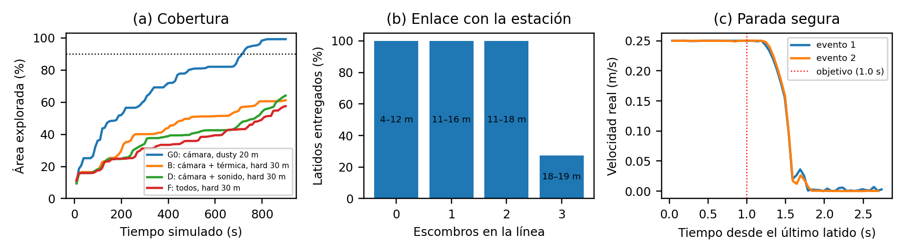
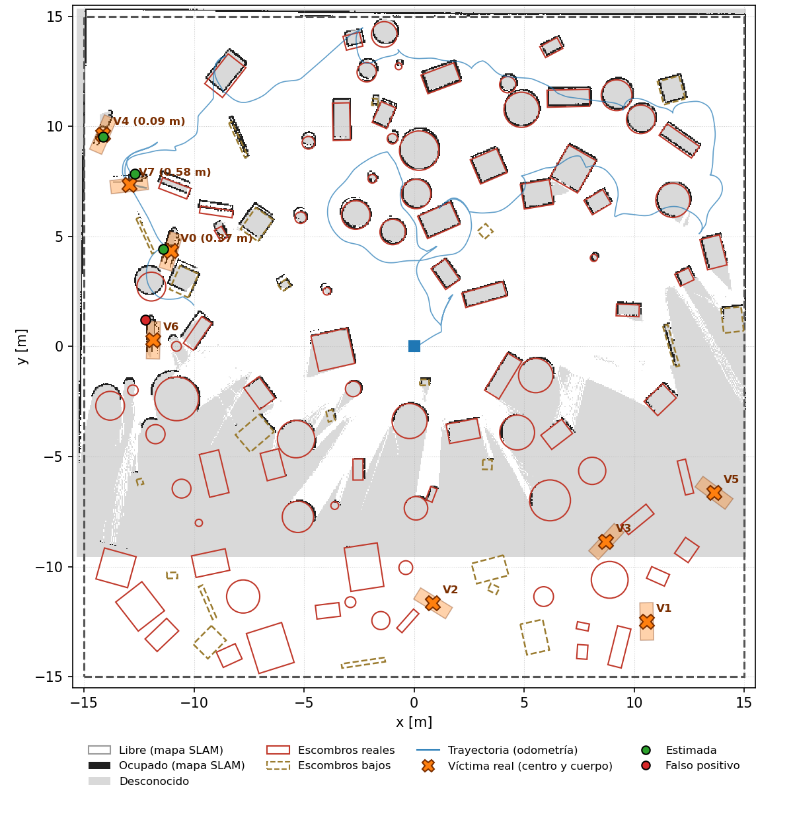

Proyecto de grado, Ingeniería Electrónica (UNAD) · Autoría: [VERIFICAR: dato faltante] (V1) · 22 de noviembre de 2026

> **Resultado general.** De 17 especificaciones se cumplen 7, 5 se cumplen en parte, 3 no se cumplen y 2 no se validaron. El modelo funciona integrado en simulación, pero **la evidencia todavía no permite declarar TRL 4 para el sistema completo**.

## 1. Introducción y alcance

Este informe dice qué hace el modelo, qué se midió y qué falta. Importa porque un robot de búsqueda que falla sin avisar deja víctimas sin encontrar o expone a los rescatistas.

El alcance es la validación en entorno simulado (Gazebo, simulador físico, y RViz, visor de datos), sin construcción de hardware. El TRL (*Technology Readiness Level*) es una escala de 1 a 9 de madurez tecnológica. La campaña se cerró antes de terminar: solo se usan corridas guardadas, casi todas con una semilla (número que reproduce un escenario).

> **En resumen.** Es una validación parcial en simulación: lo que no se midió figura como «no validado».

## 2. Descripción de la implementación

Se describe qué piezas forman el sistema y cómo pasan los datos entre ellas. Si una pieza falla, el robot pierde el mapa, las detecciones o el contacto con la estación.

El sistema usa ROS 2 (programas que intercambian mensajes por «tópicos»; Macenski, Foote et al., 2022) y tiene cinco capas:

1. **Escenario** (`usar_worldgen`): genera escombros, víctimas y el *ground truth* (la verdad de referencia, que el robot no conoce).
2. **Simulación** (`usar_description`, `usar_sim_sensors`, `usar_firmware_sil`): robot, sensores, señal WiFi y lógica del firmware.
3. **Navegación** (`usar_bringup`): un EKF (filtro que fusiona ruedas e IMU), SLAM (mapear y ubicarse a la vez; Macenski & Jambrecic, 2021) y Nav2 (planifica y sigue rutas; Macenski et al., 2020).
4. **Misión** (`usar_station`, `usar_detection`, `usar_exploration`): teleoperación (manejo a distancia) desde la estación y detección. La exploración autónoma por fronteras, los bordes entre lo conocido y lo desconocido (Yamauchi, 1997), es una capacidad adicional.
5. **Evaluación** (`usar_metrics`): compara con el *ground truth*.

En teleoperación, los mandos van de la estación al relé del enlace, al filtro de colisión, al firmware y a las ruedas. Los sensores vuelven por el mismo relé, que retrasa o descarta mensajes según la señal. El diseño eléctrico usa un cable USB 3.0 de unos 5 m: **el WiFi simulado es una alternativa inalámbrica** y sus parámetros son supuestos [VERIFICAR: dato faltante] (V2).

**Tabla 1**
*Sensores y actuadores del diseño*

| Elemento y referencia | En la simulación | Tópico |
|-----------------|--------------------------|----------------------|
| 2 motores TT 1:48 con encoder | DiffDrive o firmware en el lazo | `/cmd_vel`, `/odom`, `/joint_states` |
| IMU MPU6050 | Giro y aceleración con ruido | `/imu/data_raw` |
| LiDAR RPLiDAR A1 (mide distancias con láser) | Láser 2D, 360° | `/scan` |
| Cámara RGB-D RealSense D435 | Color y profundidad | `/camera/*` |
| Monitor de batería | No se simula | `/battery_state` |
| Cámara térmica MLX90640 | Temperatura con ruido | `/thermal/image` |
| CO₂ TGS4161 | Pluma y respuesta lenta | `/co2/concentration` |
| Micrófonos ReSpeaker | Dirección del sonido | `/sound/doa` |
| Radar Doppler HB100 | Señal de respiración | `/radar/signal` |

*Nota.* Elaboración propia a partir de `CLAUDE.md`.

> **En resumen.** Todas las capas están implementadas. La estación, el enlace y el firmware en el lazo solo tienen comprobaciones cortas.

## 3. Operación en tiempo real

Se probó si la lógica del firmware (el programa del microcontrolador) controla el robot simulado a su ritmo. Si se atrasara, el robot giraría o frenaría tarde.

*Software-in-the-loop* es correr el código de control en el computador, conectado al simulador. `usar_firmware_sil` compila sin cambios el PID (regulador de velocidad), el limitador, la odometría (posición según las ruedas) y el vigilante de `hardware/firmware/lib/robot_core`. El ciclo de `main.cpp` está reproducido, no compilado, y no se ejecutó el binario del ESP32.

En la comprobación T (229 s, operador simulado, interrumpida), el control leyó los encoders simulados y mandó par a las ruedas a **50,03 Hz**. El 90 % de los periodos quedó entre 18,5 y 21,5 ms. El *real time factor* (segundos simulados por segundo de reloj) fue 0,96 con el equipo libre y 0,61–0,74 con otras tareas en paralelo.

El LiDAR ofreció 5,77 Hz y la cámara 7,66 Hz al enlace, porque el limitador de 10 Hz descarta una de cada dos imágenes de una fuente de 15 Hz. Los latidos de la estación tardaron 4,6 ms (mediana) y 8,5 ms (percentil 95). Es el retraso del modelo de red, no la latencia entre comando y movimiento, que no se midió. Tampoco se registraron CPU, RAM ni la frecuencia de la IMU.

> **En resumen.** La lógica del firmware controla el robot simulado a 50 Hz. El tiempo real depende de la carga del computador.

## 4. Orden y seguridad

Se revisó que el diseño proteja la electrónica y que el robot se detenga si pierde el enlace. Si esto fallara, podría dañarse o seguir avanzando sin control.

**a) Diseño eléctrico** (`hardware/kicad/out/findbot.pdf`, `findbot.net`; diagrama de bloques en `hardware/CLAUDE.md`). El cableado va de la batería con BMS al interruptor, al fusible F1 de 5 A y a la protección de inversión IRF4905. De ahí se separa en motores (VBAT) y dos reguladores: 5 V para USB y 5 V auxiliar con filtro LC. Los 3,3 V de las señales salen del ESP32.

Los módulos comparten una sola red GND y tienen desacople (470 y 100 µF en potencia, 100 nF en señal). Una resistencia mantiene el TB6612 (puente de motores) apagado al arrancar. La revisión eléctrica de KiCad da 0 errores y 0 advertencias (`erc.rpt`). La separación física de pistas no se puede evaluar sin diseño de PCB.

**b) Soporte** (`findbot.urdf.xacro`, `robot.yaml`). El chasis modelado mide 0,22 × 0,16 × 0,066 m, con ruedas de 65 mm y rueda loca. El LiDAR barre a 0,145 m del suelo. Cámara, térmica y radar miran al frente, los micrófonos van atrás y la IMU al centro.

**c) Software.** Se midieron como máximo 0,284 m/s y 1,088 rad/s. Los *costmaps* (mapas de costo alrededor de obstáculos) usan un radio de 0,23 m. No hubo contacto geométrico con escombros ni víctimas en 4 corridas revisadas a 1 Hz (separación mínima 0,06 m); un roce entre muestras no se detectaría.

Al perder el enlace, el *failsafe* (parada automática) tardó 1,09–1,12 s en detectarlo y 0,45–0,67 s más en detener el robot. En los dos casos en avance recorrió 0,36 m sin enlace. **No cumple el objetivo de 1,0 s**: la espera del latido ya dura 1,0 s, y el vigilante de 0,5 s del firmware no actúa mientras Nav2 siga enviando velocidades.

> **En resumen.** El diseño eléctrico pasa su revisión y se respetan los límites de velocidad. La parada por pérdida de enlace funciona, pero es lenta.

## 5. Plan de pruebas

El plan dice cómo comprobar cada especificación (E1–E17, sección 8). Sin él, un resultado aislado podría pasar por validación.

**Tabla 2**
*Casos de prueba y estado de ejecución*

| Caso · OE | Verifica | Condiciones y procedimiento (argumentos de la sección 9) | Registro | Aceptación | Ejecutado |
|-----------|---------|-----------------------------|-----------|---------------|---------------|
| P1 Teleoperación · OE3 | E5, E6 | Recorrido desde la estación; `teleop:=true comm:=true` | CSV, rosbag (grabación de tópicos) | ≤ 200 ms; cámara ≥ 10 Hz | Parcial: T, sin operador humano |
| P2 Comunicación · OE4 | E4, E7 | Espacio libre y 1–3 escombros; cortar el enlace | CSV, rosbag | 30 m; 10 m con 2; parada ≤ 1 s | Parcial: dentro de T |
| P3 Detección · OE4 | E1–E3 | 10 semillas × 3 dificultades | JSON, CSV | ≥ 80 %; ≤ 1; ≤ 0,5 m | Parcial: 4 misiones |
| P4 Tiempos · OE4 | E11, E12 | Teleoperado y autónomo, 60 misiones | CSV | ≥ 90 %; tiempos en ambos modos | Parcial: solo autónomo |
| P5 Tiempo real · OE3 | E8, E13 | `firmware_sil:=true` | rosbag | 50 Hz ± 10 %; ≥ 0,8 | Sí: una corrida |
| P6 Seguridad · OE4 | E9, E10 | Pose real frente a límites y obstáculos | CSV | 0 excesos; 0 contactos | Sí: 4 corridas |
| P7 Robustez · OE4 | E1, E2 | Más ruido, víctimas ocultas, metas inalcanzables | JSON | Sin caer bajo E1–E2 | No |
| P8 Mantenibilidad · OE3 | E14–E17 | `colcon test`; análisis estático | XML, CSV | 100 % pasa; ≥ 70 % cubierto | Parcial: sin cobertura |

*Nota.* Elaboración propia. OE = objetivo específico. Las dificultades son los escenarios `default`, `dusty` y `hard`.

> **En resumen.** Dos casos se ejecutaron en muestra pequeña, cinco en parte y uno no se ejecutó.

## 6. Resultados cuantitativos de desempeño

Se midió si el robot encuentra víctimas, se ubica y mantiene el enlace. Si falla aquí, no sirve para reducir el tiempo de búsqueda.

G0 es `dusty` (20 × 20 m, 5 víctimas grises). B, D y F son `hard` (30 × 30 m, 8 víctimas) con térmica, sonido y todos los sensores, además de la cámara. Todas son autónomas, con semilla 1 y 900 s. B y D compartieron el computador con otras tareas.

**Tabla 3**
*Desempeño de las misiones válidas con la geometría actual*

| Métrica | G0 | B | D | F | Media de B, D, F | Desv. | Mín. | Máx. |
|-----------------|-----|-----|-----|-----|------|-----|-----|-----|
| Víctimas detectadas (%) | 40,0 | 37,5 | 25,0 | 25,0 | 29,2 | 7,2 | 25,0 | 37,5 |
| Falsos positivos | 0 | 1 | 0 | 0 | 0,33 | 0,58 | 0 | 1 |
| Error de las detectadas (m) | 0,41 | 0,35 | 0,12 | 0,37 | 0,28 | 0,14 | 0,12 | 0,37 |
| Cobertura (%) | 99,2 | 61,2 | 64,1 | 57,5 | 60,9 | 3,3 | 57,5 | 64,1 |
| Recorrido (m) | 98,2 | 112,0 | 85,0 | 73,9 | 90,3 | 19,6 | 73,9 | 112,0 |
| Primera víctima (s) | 89 | 709 | 799 | 808 | 772 | 55 | 709 | 808 |
| Error de SLAM (m) | 0,06 | 0,09 | 0,05 | 0,06 | 0,07 | 0,02 | 0,05 | 0,09 |
| Error de las ruedas (m) | 0,82 | 0,98 | 0,29 | 0,52 | 0,59 | 0,35 | 0,29 | 0,98 |
| Error del EKF (m) | 2,12 | 0,29 | 0,96 | 0,42 | 0,56 | 0,35 | 0,29 | 0,96 |

*Nota.* Elaboración propia. Evidencia: `datos/misiones.csv` y `datos/resumen.csv`. G0 usó un sesgo de IMU pesimista, corregido después, y su área explorable se calculó con un radio de robot de 0,30 m. Se excluyen las misiones perdidas (A, C), contaminadas (E, G) y las de la geometría anterior.

**Figura 1**
*Cobertura, enlace y parada segura*

{width=17cm}

*Nota.* Elaboración propia. En (a), cada curva es una misión y la línea punteada es el 90 %: solo el escenario de 20 m la supera. En (b), cada barra da los latidos entregados según los escombros entre estación y robot, con el rango de distancia: hasta dos no hubo pérdidas y con tres llegó el 27 %. En (c), cada curva es la velocidad tras el último latido: el robot se detiene hacia 1,75 s, después del límite rojo.

**Figura 2**
*Mapa construido frente al ground truth, misión B*

{width=7.4cm}

*Nota.* Elaboración propia con `usar_metrics`. Los ejes están en metros. El gris es desconocido, el negro es obstáculo detectado, el contorno rojo es el escombro real y la X, la víctima real. Los puntos verdes son aciertos y el rojo, un falso positivo. La línea azul es la ruta según las ruedas, que deriva y por eso parece cruzar obstáculos. Las víctimas del sur quedaron sin explorar.

La figura 2 revela un defecto. En B la forma humana, por sí sola, acertó 4 de 8 víctimas sin falsos positivos. Al promediar con la térmica, la posición de V6 quedó a poco más de 1 m de la real: **la fusión bajó a 3 aciertos y creó un falso positivo**. Aun así, fue mejor que aceptar cualquier sensor (3 aciertos y 5 falsos positivos).

En T, la estación recibió la cámara a 2,2 Hz (el relé entregó 3,4 Hz) y el LiDAR se entregó a 3,3 Hz. Se perdió el 55 % de las imágenes y el 39 % de los latidos, sobre todo con tres escombros en la línea. La teleoperación simulada halló 2 de 5 víctimas antes de interrumpirse, así que no se compara con el modo autónomo.

> **En resumen.** La localización es buena, pero la detección (25–40 %) y los datos en la estación están lejos de la meta.

## 7. Resultados de mantenibilidad

Se midió si otra persona puede cambiar el sistema sin romperlo. Si fuera difícil, cada corrección introduciría fallas nuevas.

**Tabla 4**
*Métricas de mantenibilidad*

| Métrica | Valor | Interpretación |
|---------------|--------------|-----------------------|
| Pruebas automáticas | 327 casos: 319 pasan, 0 fallan, 8 omitidos | Los omitidos son revisiones de licencia |
| Estilo (flake8) | 0 avisos en 8 paquetes Python | No cubre C++ ni `scripts/` |
| Modularidad | 10 paquetes ROS 2 | Una responsabilidad por paquete |
| Código Python | 7 774 líneas y 2 885 de pruebas | 0,37 líneas de prueba por línea de código |
| Parámetros en YAML | 311 de 311 ajustables (100 %) | Se ajusta sin tocar el código |
| Documentación | 13 documentos en `docs/` | Decisiones por fase |
| Compilación incremental | 6,1 s | No se midió desde cero |
| Cobertura de pruebas, complejidad, tiempo de reproducción | No medidos | Pendientes |

*Nota.* Elaboración propia. Evidencia: `datos/pruebas_software.csv`, `datos/mantenibilidad.csv` y salida de `colcon build` (no archivada).

> **En resumen.** El código es modular, configurable y probado, pero no se sabe qué porcentaje cubren las pruebas.

## 8. Matriz de validación de especificaciones

La matriz compara lo diseñado con lo obtenido. Evita que un buen resultado aislado oculte los incumplimientos.

**Tabla 5**
*Matriz de validación de especificaciones*

| ID | Especificación | OE | Valor diseñado | Valor obtenido (media ± desv.) | Desviación (%) | ¿Cumple? | Evidencia |
|----|------------|----|---------|--------------|-------|----------|-----------|
| E1 | Detección de presencia | 4 | ≥ 80 % | 31,9 ± 8,0 % (n = 4: dusty y hard) | −60 | **No** | misiones |
| E2 | Falsos positivos por misión | 4 | ≤ 1 | 0,25 ± 0,50 (n = 4) | −75 | Sí | misiones |
| E3 | Error al ubicar víctimas | 4 | ≤ 0,5 m | 0,31 ± 0,13 m (solo detectadas) | −37 | Sí | misiones |
| E4 | Alcance del enlace | 4 | 30 m libre; 10 m con 2 escombros | 12,4 m libre (máx. probado); 17,7 m con 2 | −59; +77 | Parcial | enlace_capas |
| E5 | Latencia comando–movimiento | 3 | ≤ 200 ms | No medida | – | No validado | – |
| E6 | Datos en la estación | 3 | Cámara ≥ 10 Hz; LiDAR ≥ 5 Hz | 3,4 y 3,3 Hz entregados | −66; −34 | **No** | topicos |
| E7 | Parada al perder el enlace | 3 | ≤ 1,0 s (0,5 + frenado) | 1,70 ± 0,10 s (n = 5) | +70 | **No** | parada_segura |
| E8 | Lazo del firmware | 3 | 50 Hz ± 10 % | 50,03 Hz | +0,1 | Sí | tiempo_real |
| E9 | Límites de velocidad | 4 | 0,30 m/s; 1,5 rad/s | 0,284; 1,088 (máximos) | −5; −27 | Sí | tiempo_real |
| E10 | Colisiones | 4 | 0 | 0 en 4 corridas, muestreo 1 Hz | 0 | Parcial | colisiones |
| E11 | Cobertura autónoma, 20 m | 4 | ≥ 90 % | 99,2 % (n = 1) | +10 | Parcial | misiones |
| E12 | Tiempo de localización | 4 | Medido en ambos modos | Solo autónomo, a la primera: 772 ± 55 s (hard), 89 s (dusty) | – | Parcial | misiones |
| E13 | *Real time factor* | 3 | ≥ 0,8 | 0,96 libre; 0,67 ± 0,09 con carga | +20; −16 | Parcial | tiempo_real, misiones |
| E14 | Mundo reproducible | 4 | Archivo idéntico | Idéntico con 3 semillas | 0 | Sí | test_reproducibility.py |
| E15 | Pruebas y estilo | 3 | 100 %; 0 avisos | 319/319 ejecutadas; 0 avisos | 0 | Sí | pruebas_software |
| E16 | Cobertura de pruebas | 3 | ≥ 70 % | No medida | – | No validado | – |
| E17 | Parámetros en YAML | 3 | 100 % | 100 % | 0 | Sí | mantenibilidad |

*Nota.* Elaboración propia. La evidencia son los CSV de `results/informe/datos/`. Los valores diseñados que no vienen de `CLAUDE.md` (E1–E6, E10, E11, E13, E16) son propuestas del equipo [VERIFICAR: dato faltante] (V3). E7 toma los 0,5 s del firmware más 0,5 s de frenado. «Sí» vale solo para la muestra indicada.

> **En resumen.** Se cumplen 7, en parte 5, no se cumplen 3 y no se validaron 2.

## 9. Evidencia de TRL 4

Se comprueba qué nivel de madurez respalda la evidencia. Declarar un nivel mayor llevaría a confiar en funciones no probadas. La Comisión Europea define TRL 4 como «technology validated in lab», tecnología validada en laboratorio (European Commission, 2014). Aquí el laboratorio es el entorno simulado.

**Tabla 6**
*Criterios de TRL 4 adoptados para este proyecto*

| Criterio | Evidencia | ¿Se demuestra? |
|---------------|-----------------------------|----------|
| Componentes validados por separado | 319 pruebas de software; 72 criterios eléctricos y 43 pruebas de firmware (`hardware/docs/REPORTE_SIMULACION.md`) | Sí |
| Subsistemas integrados en laboratorio | T: firmware, Gazebo, enlace, estación y detección juntos | Sí, una corrida |
| Desempeño validado contra especificaciones | Tabla 5: 7 de 17 | No |
| Repetible por un tercero | Comandos siguientes; mundo reproducible | En parte: datos crudos fuera de git |

*Nota.* Elaboración propia. Los criterios interpretan la definición oficial, que no los detalla.

Para reproducir la demostración, dentro del contenedor del proyecto y desde la raíz del repositorio:

```
cd usar_ws && colcon build --symlink-install && source install/setup.bash
ros2 launch usar_bringup mission.launch.py seed:=1 world_params:=dusty      # autónomo
ros2 launch usar_bringup mission.launch.py seed:=1 world_params:=dusty \
  firmware_sil:=true comm:=true teleop:=true operator:=simulated            # corrida T
ros2 launch usar_bringup mission.launch.py seed:=1 world_params:=hard use_thermal:=true   # B
python3 ../results/informe/generar_datos.py     # cifras y figuras (requiere los datos crudos)
```

> **En resumen.** Hay componentes validados e integración demostrada. El TRL 4 del sistema completo sigue pendiente.

## 10. Cumplimiento de objetivos

Se relaciona cada objetivo con su evidencia. Un objetivo sin medición no se da por cumplido.

**Tabla 7**
*Cumplimiento de objetivos*

| Objetivo | Evidencia | Estado |
|---------------------|--------------------------------|--------|
| General: diseñar y simular un robot teleoperado de bajo costo que detecte señales de vida y evaluar su potencial | Diseño y simulación completos; costo estimado de 540 USD básico y 722 USD con todos los sensores [VERIFICAR: dato faltante] (V4). Sin evaluación de tiempo ni de exposición del personal | Parcial |
| OE3: integrar hardware y firmware, con teleoperación y transmisión a una estación | Firmware a 50 Hz, estación y enlace funcionando. Fallan E6 y E7; sin operador humano | Parcial |
| OE4: validar detección, alcance y tiempo de recorrido, y estimar la reducción del tiempo | E1 no cumple; E4 y E12 parciales; sin referencia citable de búsqueda manual [VERIFICAR: dato faltante] (V5) | No cumplido |

*Nota.* Elaboración propia.

> **En resumen.** El objetivo general y OE3 se cumplen en parte. OE4 necesita la campaña pendiente.

## 11. Conclusiones

Se explica cada desviación y cómo corregirla. Sin este análisis, las mismas fallas volverían en la siguiente campaña.

**Tabla 8**
*Análisis de las desviaciones*

| ID | Causa probable | Impacto en el PMV (producto mínimo viable) | Acción correctiva |
|-----|----------------------|----------------|----------------------|
| E1 | 15 min no alcanzan en 30 m; el LiDAR mapea sin que la cámara mire; la fusión desplaza posiciones | Víctimas omitidas | Explorar según lo visto por la cámara; usar la posición del sensor más preciso |
| E2, E3 | Favorables, pero E3 ignora las omitidas | Optimismo por muestra pequeña | Repetir con 10 semillas |
| E4 | No se probó más allá de 12,4 m en línea libre; con 3 escombros cae al 27 % | Pérdida de control | Barrido de distancia; repetidor o cable |
| E5, E16 | Pruebas no ejecutadas | Desempeño y calidad sin demostrar | Prueba de escalón; pytest-cov |
| E6 | Limitador defectuoso (7,7 Hz) y enlace débil | El operador ve a saltos | Corregir el limitador; bajar la resolución |
| E7 | Latido de 1,0 s; Nav2 alimenta el vigilante | 0,36 m sin control | Latido de 0,4 s; cortar la velocidad a la salida |
| E8, E9 | Desviaciones dentro del margen | Ninguno | Mantener |
| E10 | Muestreo a 1 Hz | Roces no vistos | Sensor de contacto |
| E11, E12 | Una semilla; sin teleoperación completa | No se puede comparar ni estimar ahorro | 60 misiones pareadas |
| E13 | Tareas en paralelo | Corridas cortadas por tiempo | Equipo dedicado; más margen |

*Nota.* Elaboración propia. E14, E15 y E17 no tienen desviación.

**Limitaciones del modelo.** Los sensores de gas, sonido, radar y radio son modelos sin calibrar. La odometría del firmware en el lazo es optimista (error de 0,001 m), porque usa geometría exacta. El EKF solo mejoró a las ruedas en B y F; en D las empeoró. El mundo se repite por semilla, pero la misión no.

Hay incoherencias con el firmware: también publica la TF (árbol de posiciones) que ya da el EKF, envía la IMU a 50 Hz y no a 100 Hz, y aún no publica radar ni CO₂. La evidencia de texto de su prueba micro-ROS se perdió [VERIFICAR: dato faltante] (V6). Los datos del motor y del encoder son del catálogo o supuestos [VERIFICAR: dato faltante] (V7).

**Trabajo futuro:** aplicar las acciones de la tabla 8, ejecutar las 60 misiones y las teleoperadas por una persona, y probar robustez y sensibilidad a los parámetros.

> **En resumen.** El modelo permite encontrar fallas de diseño a bajo riesgo. Tres incumplimientos deben corregirse antes de repetir la validación.

## 12. Glosario

Reúne los términos técnicos que más se repiten. Entenderlos evita leer mal un resultado.

**Cobertura:** porcentaje del área alcanzable que aparece en el mapa. **Encoder:** sensor de giro de la rueda. **Falso positivo:** detección a más de 1 m de toda víctima. **IMU:** sensor de giro y aceleración. **Latido:** mensaje periódico que confirma el enlace. **Percentil 95:** valor que no supera el 95 % de las muestras. **RSSI:** potencia de señal recibida. **TF:** árbol de posiciones entre las partes del robot. **YAML:** archivo de parámetros legible.

> **En resumen.** Los demás términos se definen donde aparecen por primera vez.

## 13. Referencias

Son las fuentes citadas, verificadas en el documento del editor o en Crossref. Una cita errónea restaría validez al informe.

European Commission. (2014). *Horizon 2020 work programme 2014–2015: General annexes, G. Technology readiness levels (TRL)* (Decisión C(2014)4995). https://ec.europa.eu/research/participants/data/ref/h2020/wp/2014_2015/annexes/h2020-wp1415-annex-g-trl_en.pdf

Macenski, S., Foote, T., Gerkey, B., Lalancette, C., & Woodall, W. (2022). Robot Operating System 2: Design, architecture, and uses in the wild. *Science Robotics, 7*(66), eabm6074. https://doi.org/10.1126/scirobotics.abm6074

Macenski, S., & Jambrecic, I. (2021). SLAM Toolbox: SLAM for the dynamic world. *Journal of Open Source Software, 6*(61), 2783. https://doi.org/10.21105/joss.02783

Macenski, S., Martín, F., White, R., & Ginés Clavero, J. (2020). The Marathon 2: A navigation system. En *2020 IEEE/RSJ International Conference on Intelligent Robots and Systems (IROS)* (pp. 2718–2725). IEEE. https://doi.org/10.1109/IROS45743.2020.9341207

Yamauchi, B. (1997). A frontier-based approach for autonomous exploration. En *Proceedings 1997 IEEE International Symposium on Computational Intelligence in Robotics and Automation CIRA'97* (pp. 146–151). IEEE. https://doi.org/10.1109/CIRA.1997.613851


> **En resumen.** Cinco fuentes sustentan las herramientas, el método y la escala TRL.

## 14. Anexo: requisitos del tutor

Relaciona cada requisito con su evidencia, para ubicar rápido lo que falta.

**Tabla 9**
*Cumplimiento de los requisitos del tutor*

| Requisito | Sección | Evidencia | Estado |
|-------------------|----|---------------------|---------|
| Operación en tiempo real | 3 | `datos/tiempo_real.csv`, `datos/topicos.csv` | Parcial |
| Orden y seguridad | 4 | `erc.rpt`, `datos/parada_segura.csv`, `datos/colisiones.csv` | Parcial |
| Informe de implementación TRL 4 | 1–14 | Este documento | Entregado |
| Matriz de validación | 8 | Tabla 5 | Entregada |
| Plan de pruebas | 5 | Tabla 2 | Diseñado; ejecución parcial |
| Resultados de desempeño y mantenibilidad | 6, 7 | `datos/resumen.csv`, `datos/mantenibilidad.csv` | Parcial |
| Evidencia de TRL 4 | 9 | Tabla 6 | Parcial |

*Nota.* Elaboración propia.

> **En resumen.** Todos los requisitos tienen sección, pero cinco solo tienen evidencia parcial.
